# TVCN 内容仓 / TVCN Content Repository

这是 [TVCN 影像知识站](../prototype/tvcn-ui-v2.html) 的双语内容仓。站点主文件在
`v2/prototype/tvcn-ui-v2.html`；这里放的是可与站点逐篇对照的 Markdown、封面字段与图解资产，
方便单独审阅、翻译、迁移到静态站点生成器，或在未来拆成内容仓部署。

## 数字

| 项目 | 数量 |
| --- | ---: |
| Markdown 文件 | 928 |
| 中英配对 | 464 |
| 内容站 | 9（主站 + 8 个二级分站） |
| published | 928 |
| 带 `diagram` 字段 | 928 |
| 英文结构稿已审校 | 72 |
| context 带来源配对 | 42 |
| 公开来源条目 | 40 |
| 经验型标记文件 | 130 |
| 带深读的配对 | 83 |
| 深读 Markdown | 166 |
| 模板正文逐篇重写 | 464 对 |
| 主题专属验收 | 464 对 × 3 条 |

当前 928 / 928 个文件为 `status: published`；`published` 不是“文件存在”的同义词，而是明确的发布信号。
`check-content.mjs` 会挡住缺字段、缺图、图解块与图片路径不一致的条目。

72 个英文结构稿做过中英对照审校（结构、术语与无中文残留；不是第二次母语逐句润色）。
context 站 42 对在文末列出延伸阅读，具体链接集中在 [`SOURCES.md`](SOURCES.md) 的 40 条来源里。
另有 130 个文件用 `source_kind: experience` 明确标成经验型内容，不伪造外部引用。
83 对文章带 `depth: deep` 与 `<!-- DEEP_DIVE_START -->` 深读块，共 166 个中英文文件；深读与站点逐篇对应，不是另一套独立文章。

2026-11-22 已把 464 对页面的“怎么做 / Do this”正文逐篇重写，并把每篇 3 条验收改为主题专属；中文与英文、站点与 Markdown 同步，共涉及 928 个文件。

## 目录

```text
main/       主站：路径、方法卡、案例、工具卡、路径页
story/      故事与编剧：剧本、分镜、导演、表演
shoot/      拍摄：机位、曝光、灯光、录音、安全
post/       后期：剪辑、调色、声音、交付
ai/         AI 影像：生成、一致性、数字人、伦理
animation/  动画：二维、三维、定格、动效、管线
formats/    片型：19 种片型的模板与拆解
tools/      工具：器材、选购、排障、计算器
context/    影像史与素养：历史、法律、平台、媒介素养
images/
  diagrams/en/   394 个 SVG，中文 394 / 英文 394；928 个页面引用
```

每个站再按 `zh/`、`en/` 分目录；目录层级保留 `paths/`、`screenplay/`、`history/photography/`
这类原有结构。文件名是 slug，不等于 `id`；跨语言用 `translation_key` 配对。

## Frontmatter

```yaml
---
id: main.paths.first-film
site: main
type: path
lang: zh
translation_key: main.paths.first-film
translation_status: source
title: 7 天第一条片
summary: 用手机或一台轻便相机，在 7 天内完成一条 60–90 秒的完整短片。
slug: first-film
canonical_site: main
canonical_path: /start/first-film/
status: draft
diagram: /images/diagrams/zh/first-film.svg
diagram_alt: 7 天第一条片：每天只做一件
diagram_caption: 每天只做一件：定题、分镜、备机、拍完、补镜、粗剪、发布。
last_verified: 2026-11-20
review_due: 2027-05-20
---
```

正文在导语之后有一段被注释包裹的图解块：

```html
<!-- DIAGRAM_START -->
## 图解
<figure>
  
  <figcaption>...</figcaption>
</figure>
<!-- DIAGRAM_END -->
```

`diagram` 字段和正文 `` 必须一致；中文图在 `images/diagrams/zh/`，英文图在
`images/diagrams/en/`。路径以 `/images/...` 开头，当前按“内容仓根目录就是站点根”来解析。

## 单独部署时怎么处理图片

当前 Markdown 的图片路径是仓库根相对路径 `/images/diagrams/<lang>/<slug>.<ext>`。
如果未来把内容仓单独部署到 `content.tvcn.org` 或某个子路径，有两种做法：

1. 把 `images/` 目录挂到站点根，保持 `/images/...` 不变；
2. 在生成器里加一个 `media_base` 变量，发布时把 `/images/...` 重写为
   `https://content.tvcn.org/images/...` 或 `./images/...`。

在未确认媒体托管方式前，不要手工改这 928 个路径；`check-content` 会按当前约定检查前缀。

## 两个非文章页

`main/paths/first-film.md` 和 `tools/calculators/fov.md` 也在这 464 对里。它们的图解是
`build/make-extra-diagrams.py` 生成的 1280×720 手绘示意图，不是站点内联图的逐像素导出；
如果用“内容仓与站点完全同图”作为验收口径，这两张需要另做站点版导出。

## 重新生成索引

内容增删或标题变化后运行：

```powershell
python build/make-content-index.py
```

它会重写 `index.json`、`INDEX.md` 和本文件的计数区；不要手改生成段。
完整的站点生成仍是：

```powershell
python build/generate.py
```

`generate.py` 写完 Markdown 后会调用索引脚本；如果只改了 Markdown，也可以单独跑索引脚本。

## 校验

在 `v2` 目录运行：

```powershell
node scripts/check-content.mjs
```

它检查字段、双语配对、`canonical_path`、图解字段、图解资产、图解块、`img src` 一致，
并核对 `index.json` 的 928 条记录与磁盘文件一致。

## 许可

文字、术语、原创图解：CC BY-SA 4.0，见仓库根目录 `LICENSE-CONTENT`。
代码、构建脚本、站点引擎：MIT，见 `LICENSE`。TVCN 名称与标识不在上述许可内。

---

## English

This is the bilingual content repository for the TVCN video-knowledge site. It contains
928 Markdown files in 464 zh/en pairs, grouped into 9 content sites,
plus 928 diagram references backed by 394 SVG files. Every document carries a `diagram` field and a
`<!-- DIAGRAM_START -->` figure block. `status` is an explicit publication signal; currently
928 of 928 files are published. The machine-readable index is [`index.json`](index.json); the human-readable table of contents is
[`INDEX.md`](INDEX.md). 83 pairs carry `depth: deep` and a `<!-- DEEP_DIVE_START -->` block,
166 files in both languages; the deep dives correspond one-to-one with site articles, not a separate set. Image paths use `/images/diagrams/<lang>/<slug>.<ext>` relative to the
content-repo root. If the repository is deployed separately, either mount `images/` at the site root
or add a `media_base` rewrite in the generator.

Run `python build/make-content-index.py` after content changes, then `node scripts/check-content.mjs`
from `v2/` to verify fields, pairs, diagrams and the index.
