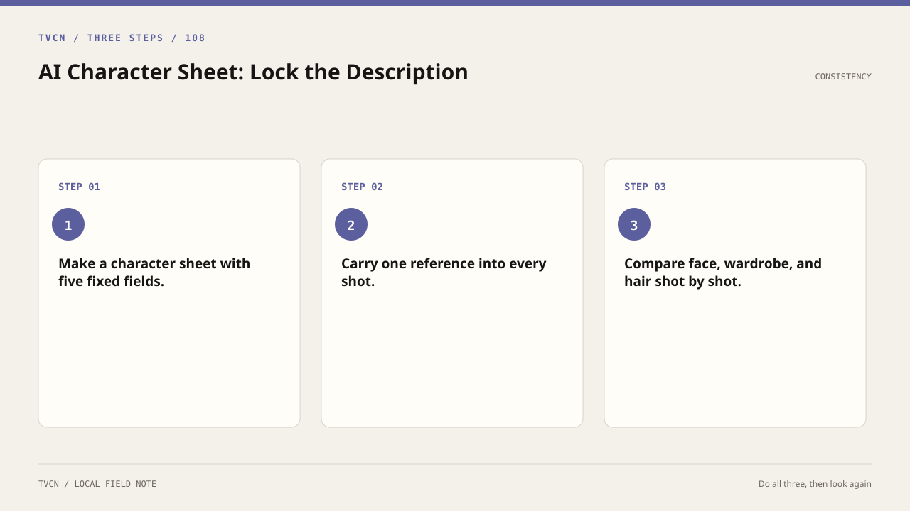

Lock five fields: face, age, hair, wardrobe, temperament. Carry them into every generation.

<!-- DIAGRAM_START -->
<h2>Diagram</h2>
<figure>
  
  <figcaption>Do the three steps in order, then look again at the image or file.</figcaption>
</figure>
<!-- DIAGRAM_END -->
<h2>On set</h2>

Five fields, one fixed sentence each. Add a three-view sheet and carry the same face and text into every generation.

<h2>Do this</h2>

An AI character sheet locks five fields: face, age, hair, wardrobe, and presence, carried into every generation.
<ol><li>Write five fields, one fixed sentence each.</li><li>Attach a three-view sheet and use the same face and text every time.</li><li>Compare face, wardrobe, and hair per shot and return to the sheet when they drift.</li></ol>
<h2>Avoid</h2>

Do not expect “same person” to lock a character; the model has no memory.

<h2>Check</h2>
<ul><li>All five fields have one fixed sentence, not a keyword pile.</li><li>Every shot carries the same three-view sheet and the same description.</li><li>Face, wardrobe, and hair show no obvious drift across shots.</li></ul>

<!-- DEEP_DIVE_START -->
## Deep dive

<strong>About 5 minutes.</strong> A character sheet is not a mood description; it is a wanted poster you can reuse.

### Five fixed fields on the sheet

Age, hair, wardrobe, build, and one memory point: one value each. Do not write “a bit cool”; write “a short scar through the left eyebrow.” The more it reads like a wanted poster, the more reusable it is.

Wardrobe needs color, material, and collar; keep it fixed within a scene. Store the character sheet separately from the location sheet, or changing a room will change the face.

### Three stubborn methods

Same reference, same seed, same description, all three together; drop one and the face drifts. Cover a frontal line with a profile, cover a full body with a medium, and stop asking one generation to solve every angle.

Every ten images, put the three-view and the latest generation side by side. If you can see the difference at a glance, so can the audience.

### More references is not better

One clear front half-body is more useful than ten angles. With many references the model compromises between them and resembles none.

Generate a profile separately and add it to the sheet; do not throw every image in at once.

### Three symptoms of drift

A wider face, a higher hairline, and lighter wardrobe are the first three signs of drift. Do not wait for the eyes to break.

Every five shots, compare the first, the previous, and the current side by side. On one screen the difference is obvious.

### Ten fields on a character sheet; miss one and it drifts
<ul><li>Age is one specific number</li><li>Hair is length, part, and color</li><li>Wardrobe is color, material, and collar</li><li>Build is height and shoulder width</li><li>Memory point is a scar or one accessory</li><li>One clear frontal reference is enough</li><li>Generate profile and back separately, then file them</li><li>Store character and location sheets apart</li><li>Every five shots, compare first, previous, current</li><li>If it drifts, rebuild from the first shot</li></ul>
The more a character sheet reads like a wanted poster, the less it drifts. Vague “vibe” descriptions become another face. Reread all ten fields before every new scene; drift starts when you think you remember. Read the sheet first, then generate.

<!-- DEEP_DIVE_END -->
