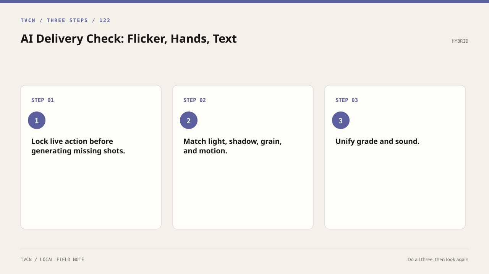

Check flicker, hands, text, and lip sync. Any one breaks the illusion.

<!-- DIAGRAM_START -->
<h2>Diagram</h2>
<figure>
  
  <figcaption>Do the three steps in order, then look again at the image or file.</figcaption>
</figure>
<!-- DIAGRAM_END -->
<h2>On set</h2>

Check four things frame by frame: flicker, finger count, on-screen text, and lips. Watch each shot twice, once at speed and once frame by frame.

<h2>Do this</h2>

AI delivery check starts with flicker, fingers, text, and lipsync; one failure breaks the illusion.
<ol><li>Check four things frame by frame: flicker, finger count, on-screen text, lipsync.</li><li>Watch every shot twice: normal speed and frame by frame.</li><li>Timecode the failure and regenerate that shot, not the whole film.</li></ol>
<h2>Avoid</h2>

Do not watch only at normal speed; flicker and finger errors show frame by frame.

<h2>Check</h2>
<ul><li>Every shot is watched at normal speed and frame by frame.</li><li>Flicker, fingers, text, and lipsync are all logged.</li><li>Failures are timecoded and fixed at the shot level, not by regenerating the film.</li></ul>
