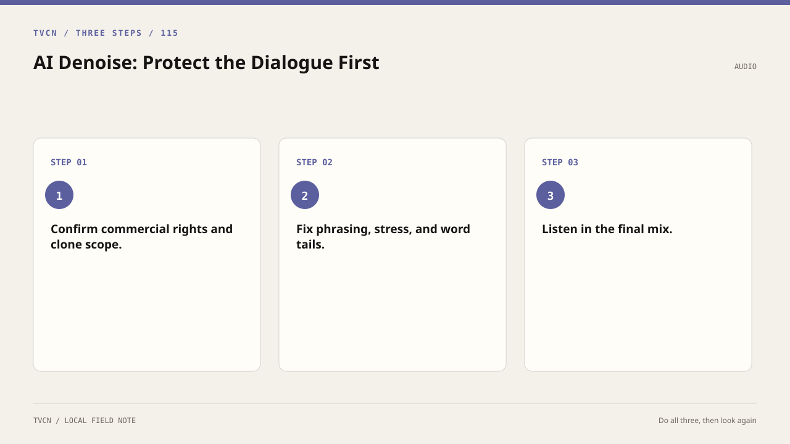

AI denoise must protect sibilance and word tails; do not turn lines into a robot.

<!-- DIAGRAM_START -->
<h2>Diagram</h2>
<figure>
  
  <figcaption>Do the three steps in order, then look again at the image or file.</figcaption>
</figure>
<!-- DIAGRAM_END -->
<h2>On set</h2>

Keep the 2 to 4 kHz sibilance and line endings. After denoising, listen to s and sh; if they turn into th, back off by half.

<h2>Do this</h2>

AI denoise protects sibilance and word tails; do not turn the voice into a robot.
<ol><li>Preserve the 2 to 4 kHz sibilance and sentence tails.</li><li>After denoise, listen to s and sh; if they become th, back off by half.</li><li>Check on a phone speaker for metallic artifacts.</li></ol>
<h2>Avoid</h2>

Do not max the denoise; losing sibilance makes the voice fake.

<h2>Check</h2>
<ul><li>S and sh remain sibilant, not turned into th or erased.</li><li>Sentence tails survive and remain audible.</li><li>On a phone speaker there is no metallic or underwater tone.</li></ul>
