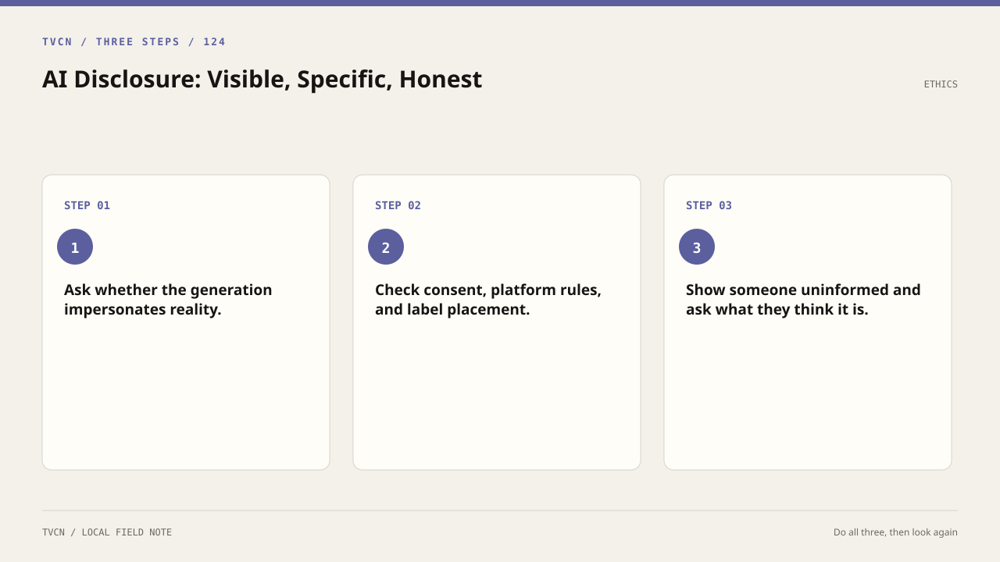

Disclosure must be visible, specific, and say what was generated; buried at the end is no disclosure.

<!-- DIAGRAM_START -->
<h2>Diagram</h2>
<figure>
  
  <figcaption>Do the three steps in order, then look again at the image or file.</figcaption>
</figure>
<!-- DIAGRAM_END -->
<h2>On set</h2>

Put a visible label in the first three seconds: some images in this film are AI-generated. Name the specific sections in the description.

<h2>Do this</h2>

AI disclosure must be visible, specific, and say which parts were generated; buried at the end of a description is no disclosure.
<ol><li>Put a visible label in the opening or first three seconds: “Some images in this film were AI-generated.”</li><li>Name the specific passages in the description.</li><li>Show someone unaware and ask which part they think is not live-action.</li></ol>
<h2>Avoid</h2>

Do not bury the label at the end of the description; if it is unseen, it was not disclosed.

<h2>Check</h2>
<ul><li>The AI label is visible in the first three seconds without pausing.</li><li>The description names the generated passages, not just “some images.”</li><li>An unaware viewer can point to at least one non-live-action passage.</li></ul>

<!-- DEEP_DIVE_START -->
## Deep dive

<strong>About 7 minutes.</strong> AI disclosure is not a legal appendix. It is the precondition for the audience to judge whether the film can be trusted.

### Three levels of use

Fully generated, live-action with generated elements, live-action with AI-assisted post. Three different disclosures. Full generation goes on the first frame or under the title; assisted post can be described in the notes.

Do not call AI-assisted editing “AI-generated,” and do not hide full generation as “assisted.” Overstating and understating are both inaccurate.

### What the audience needs to know

Which section is generated, whether the person or background is generated, whether the voice is synthetic, whether a real person was face-swapped. Four items tell the audience what to trust.

If synthetic content involves real people, brands, or news events, be more specific. Do not hide behind “some visuals were AI-assisted.”

### Platform, client, own site

Use the platform disclosure. In client contracts, write “AI labels may not be removed.” On your own site, put it under the title, on the first frame, or the first line of the description; at least one visible.

If a client asks to remove it, ask why. For real people or news contexts, decline. Labeling is a floor, not a line item.

### Five-minute drill: one disclosure line

Take a film with AI and write one line: which section, which model, what was generated, what live-action remains. Under forty words.

Show the line to someone who has not seen the film and ask which part is not real. If they can answer, the disclosure works.

### When disclosure is enough

Disclosure is enough when the audience sees it before watching, can point to the generated section, can separate voice from image, and the platform and film match. Four pass.

If one fails, do not patch it with “it is at the end of the description.” The audience will not read that far.

### Ten disclosure checks
<ul><li>Separate full generation from assisted post</li><li>Full generation on first frame or under title</li><li>Assisted post says what was used</li><li>Say which section is generated</li><li>Say person or background</li><li>Say whether voice is synthetic</li><li>Face swaps of real people stated specifically</li><li>Use platform disclosure</li><li>Contract forbids removing labels</li><li>Visible before watching</li></ul>
Disclosure is not liability avoidance. It tells the audience where to place the film before they watch it.

<!-- DEEP_DIVE_END -->
