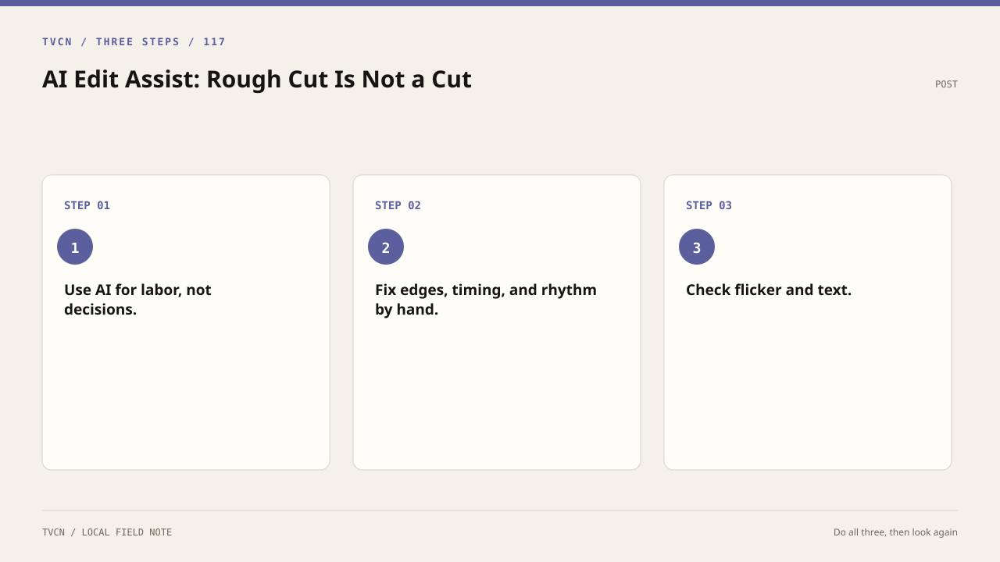

AI can find takes and cut silence, but structure and timing still need a person.

<!-- DIAGRAM_START -->
<h2>Diagram</h2>
<figure>
  
  <figcaption>Do the three steps in order, then look again at the image or file.</figcaption>
</figure>
<!-- DIAGRAM_END -->
<h2>On set</h2>

Let AI find alternate takes, cut silence, and draft subtitles. Structure, performance, and pace stay human.

<h2>Do this</h2>

AI editing assist can find footage, cut silence, and generate subtitles; structure and performance stay human.
<ol><li>Use AI for three chores: similar shots, silence removal, subtitles.</li><li>Keep structure, performance, and rhythm human.</li><li>Review every automatic result before delivery.</li></ol>
<h2>Avoid</h2>

Do not let AI lock the structure; it does not know your point.

<h2>Check</h2>
<ul><li>AI handles only shots, silence, and subtitles.</li><li>Structure and performance are human decisions and auto output is not delivered raw.</li><li>Review catches at least one AI misjudgment.</li></ul>
