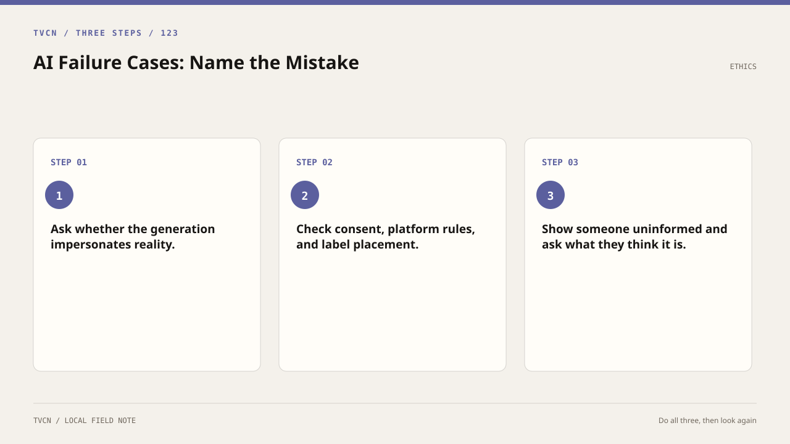

Name whether the failure was prompt, model, or post. "AI sucks" teaches nothing.

<!-- DIAGRAM_START -->
<h2>Diagram</h2>
<figure>
  
  <figcaption>Do the three steps in order, then look again at the image or file.</figcaption>
</figure>
<!-- DIAGRAM_END -->
<h2>On set</h2>

Log four causes: prompt, model version, reference, and post. Reproduce once to tell whether the prompt or the model failed.

<h2>Do this</h2>

An AI failure case names whether the prompt, model, or post caused it; “AI sucks” teaches nothing.
<ol><li>Log four elements: prompt, model version, reference, post.</li><li>Reproduce once and confirm whether prompt or model caused it.</li><li>Write one executable fix, not just “do not use AI.”</li></ol>
<h2>Avoid</h2>

Do not blame the model for every failure; prompts and post create the same breaks.

<h2>Check</h2>
<ul><li>The failure log has prompt, model version, reference, and post.</li><li>It reproduces once and identifies which element caused it.</li><li>The conclusion is one executable fix, not “AI sucks.”</li></ul>
