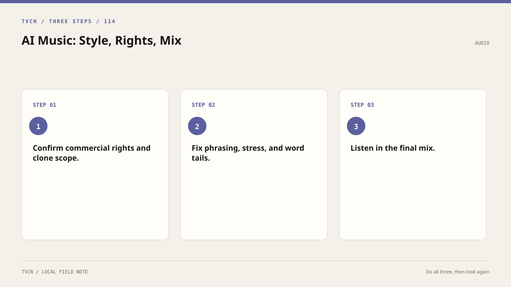

Clear commercial rights before style, and mix it under the dialogue.

<!-- DIAGRAM_START -->
<h2>Diagram</h2>
<figure>
  
  <figcaption>Do the three steps in order, then look again at the image or file.</figcaption>
</figure>
<!-- DIAGRAM_END -->
<h2>On set</h2>

Check commercial rights and training sources. Mix music to -18 to -22 LUFS and keep dialogue near -14.

<h2>Do this</h2>

AI music starts with commercial licensing, then style; mix it under dialogue.
<ol><li>Check commercial rights and training source.</li><li>Drop the music to -18 to -22 LUFS.</li><li>Keep dialogue around -14 and never let music mask words.</li></ol>
<h2>Avoid</h2>

Do not use AI music with unclear provenance commercially; a takedown arrives faster than a mix note.

<h2>Check</h2>
<ul><li>Commercial rights and training source are documented.</li><li>Music sits at -18 to -22 LUFS while dialogue stays near -14.</li><li>Soloed dialogue is word-clear and music does not mask consonants.</li></ul>
