<!-- DIAGRAM_START -->
<h2>Diagram</h2>
<figure>
  
  <figcaption>Diagram: pass six gates in order. If the first two fail, grading and music are wasted.</figcaption>
</figure>
<!-- DIAGRAM_END -->
<h2>Set the acceptance floor first</h2>
Write a floor: which errors are automatic fails (extra fingers, severed limbs, face change, completely wrong lip sync, garbled brand text), which are fixable (minor noise, edge flicker, small background objects). Without a floor, review becomes “generate one more” forever.

Watch every shot three times: normal speed for story, frame-by-frame for hands/eyes/edges, muted for lip and motion sync.
<h2>Six gates: in order, no skipping</h2>
Gate one, identity: face, hairline, wardrobe, build. Gate two, motion: continuity, time direction, intersections. Gate three, lip and voice: mismatch or a different voice fails. Gate four, text: on-screen words, logos, captions readable, no gibberish. Gate five, physics: shadows, reflections, gravity, liquids. Gate six, rights: footage, likeness, music, AI disclosure.

Do not pass a failed gate. Fix identity before grading, lip before music; wrong order doubles rework.
<h2>Fix, not “roll again”</h2>
Fix locally where possible: face replace, hand patch, lip fix, background text replace; use local repaint/comp rather than regenerating the whole shot. A full regeneration changes approved performance and light and sends you back to gate one.

Log every failure in one line: shot, error type, model/version, prompt version, fix, time. After ten, you know whether the model, prompt, or source is the problem.
<h2>Delivery and disclosure: do not make the audience guess</h2>
Disclose per platform: fully generated, live action with generated elements, live action with AI post are three different labels. Use title, description, or corner mark; do not hide it in small print. Real people, brands, and news need more specific labels.

Keep a generation log: model, date, prompt, seed, output. It is not for the audience; it is for traceability. Without it, you cannot prove which version is final.
<h2>Failure case: face passed, hands failed</h2>
An AI character short passed review on faces; identity looked strong. After delivery, the third shot had six fingers around a cup and the fifth had fingers through the cup wall. A full regeneration changed the face, forcing a return to the first version for local comp.

The fix is not “AI does that”; it is the six gates. Check face and hands separately, fix locally first, regenerate the whole shot last.
<h2>Cost and acceptance</h2>
Low: manual frame-by-frame QC plus local fixes, ¥2,000–6,000. Mid: QC sheet, local repaint, lip/text repair, ¥6,000–20,000. High: multi-model comparison, compositor, legal/rights review, ¥20,000–60,000+.
<h2>Check</h2><ul><li>Floor lists automatic fails and fixable errors.</li><li>Every shot checked normal, frame-by-frame, muted.</li><li>Six gates pass in order, no skipping.</li><li>Local fixes first; full regeneration last.</li><li>Failure log has model, prompt, fix, time.</li><li>AI label matches platform and content type.</li></ul>
<!-- SOURCES_START -->
<h2>Sources</h2>

Experience: TVCN field notes and project reviews; tested: the review setup and reproducible exercises noted on the page; references: public links below.

<ul><li>[S04] China's Interim Measures for Generative AI Services</li><li>[S05] EU AI Act policy page</li><li>[S19] Generative Adversarial Nets (2014)</li><li>[S20] Denoising Diffusion Probabilistic Models (2020)</li></ul>

<a href="../../SOURCES.md">Full links and notes in SOURCES.md</a>

<!-- SOURCES_END -->
