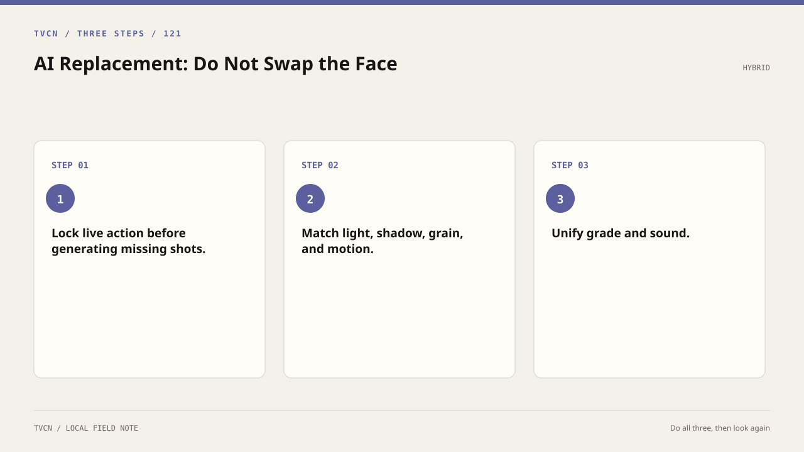

AI can replace background, weather, or crowd. Do not casually replace an actor's face.

<!-- DIAGRAM_START -->
<h2>Diagram</h2>
<figure>
  
  <figcaption>Do the three steps in order, then look again at the image or file.</figcaption>
</figure>
<!-- DIAGRAM_END -->
<h2>On set</h2>

Replace background, weather, and extras only. Keep the lead actor's real face with masks and tracking; do not generate a new face.

<h2>Do this</h2>

AI replacement can change background, weather, and crowd; do not replace the actor's face casually.
<ol><li>Change only background, weather, and extras.</li><li>Keep the lead's face from the plate and use masks and tracking.</li><li>Do not generate a full face without written permission and clear labeling.</li></ol>
<h2>Avoid</h2>

Do not swap the lead's face casually; the audience knows that face and exits the scene.

<h2>Check</h2>
<ul><li>Only background, weather, or extras change; the lead's face remains live-action.</li><li>Masks and tracking keep the face edge stable.</li><li>No full-face generation without written permission.</li></ul>
