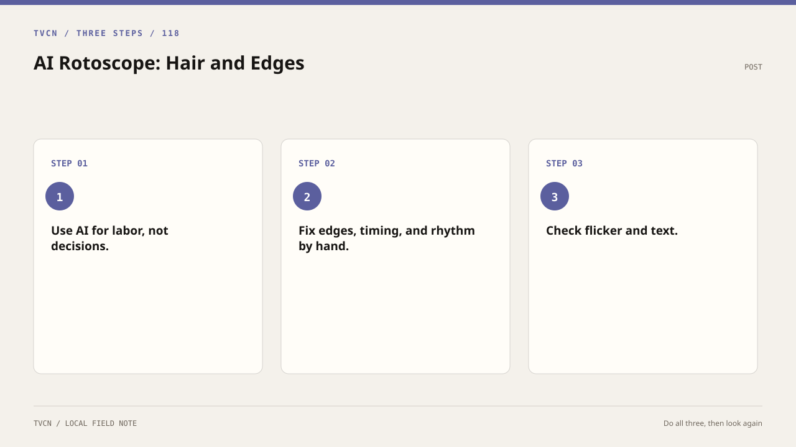

Check hair, fingers, and transparency. If those pass, the matte is usable.

<!-- DIAGRAM_START -->
<h2>Diagram</h2>
<figure>
  
  <figcaption>Do the three steps in order, then look again at the image or file.</figcaption>
</figure>
<!-- DIAGRAM_END -->
<h2>On set</h2>

Test three frames: hair edge, finger gap, clear cup. If the edge flickers, add a manual mask; do not use one global click.

<h2>Do this</h2>

AI rotoscoping starts with hair, fingers, and transparent objects; pass those three and it is usable.
<ol><li>Test three frames: hair edge, finger gaps, a glass.</li><li>If edges flicker, add manual masks.</li><li>Do not use one global key; fix the three hardest edges first.</li></ol>
<h2>Avoid</h2>

Do not deliver a one-click key; hair and fingers flicker frame to frame.

<h2>Check</h2>
<ul><li>Hair, finger gaps, and glass edges are clean in all three frames.</li><li>Edges do not flicker or eat the subject.</li><li>The three hardest edges have manual masks, not one global key.</li></ul>
