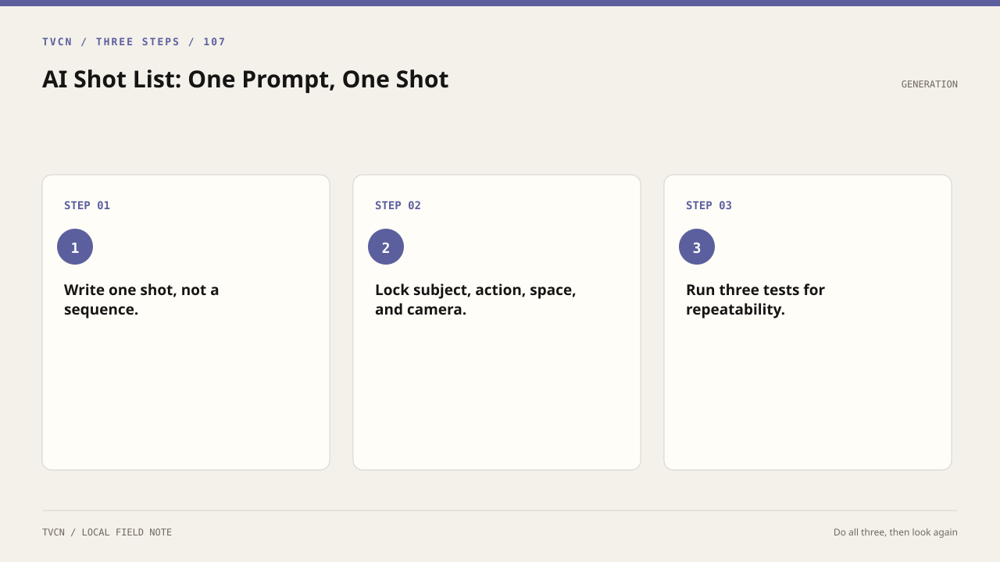

One prompt, one shot. Three events in one prompt become a random montage.

<!-- DIAGRAM_START -->
<h2>Diagram</h2>
<figure>
  
  <figcaption>Do the three steps in order, then look again at the image or file.</figcaption>
</figure>
<!-- DIAGRAM_END -->
<h2>On set</h2>

One prompt per shot, three to five seconds. The shot list records number, prompt, reference, and start and end frames; name outputs by shot number.

<h2>Do this</h2>

One prompt, one shot. A prompt with three events becomes a random cut.
<ol><li>Each prompt covers one shot of three to five seconds.</li><li>The sheet lists shot number, prompt, reference, first and last frame.</li><li>Name outputs by shot number so the edit can find them.</li></ol>
<h2>Avoid</h2>

Do not put three events in one prompt; the model cuts them into chaos.

<h2>Check</h2>
<ul><li>Each prompt maps to one shot and a three-to-five-second duration.</li><li>The sheet has shot number, prompt, reference, and first/last frame columns.</li><li>Output files are named by shot number and match the edit directly.</li></ul>

<!-- DEEP_DIVE_START -->
## Deep dive

<strong>About 6 minutes.</strong> An AI shot list is not for generating the whole film in one go. It makes every shot answer one question.

### One prompt, one shot problem

Write subject, action, environment, and camera in four parts, but change one variable at a time. Test the face today and blocking tomorrow; change five phrases at once and you will not know what worked.

One action per shot. If the character opens a door, turns, and speaks, make three prompts. The generator will not board the scene for you.

### How to accept an AI shot

Check four things: is it the same person, does the motion break, does the light match the previous shot, and are there extra fingers or text. Generate three takes and choose the one whose worst take is still usable, not the beautiful exception.

Log each failure in one line: face, hand, wardrobe, light. After ten tries you will know whether to change the tool or the prompt.

### Writing the four parts

Subject is appearance and identity; action is one verb; environment is light and space; camera is size and movement. One sentence per part, not three adjectives in one.

Writing in one language and translating often loses concrete nouns. Use words that describe visible things or the model has to guess.

### The failure log

Log four columns per generation: take number, what broke, what changed, whether it improved. Without the log you will fall into the same hole twenty times.

Review weekly and separate “change tool” from “change prompt.” Most failures are not a stupid model; they are too many changes in one prompt.

### Ten things to lock before generating
<ul><li>Change one variable per prompt</li><li>Subject is appearance and identity, not personality</li><li>Action is one verb</li><li>Environment is light and space</li><li>Camera is size and movement</li><li>Generate three takes per shot</li><li>Choose the take whose worst version still works</li><li>Log failures by face, hand, wardrobe, light</li><li>Fix reference and seed for the same character</li><li>Compare consistency every five shots</li></ul>
An AI shot list does not make the model direct for you; it turns your judgment into a reproducible page. Save the successful prompt as text in the project file, not a screenshot; next week you will need that exact line again.

<!-- DEEP_DIVE_END -->
