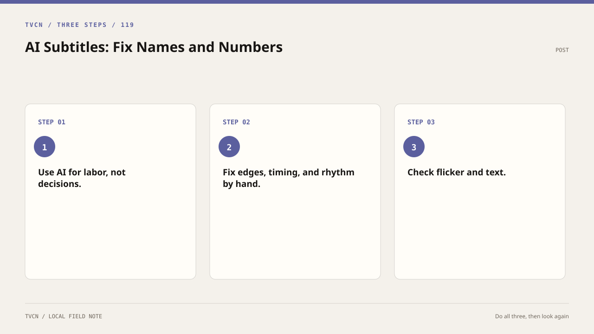

Fix names, numbers, and jargon before timing; automatic transcription fails there most.

<!-- DIAGRAM_START -->
<h2>Diagram</h2>
<figure>
  
  <figcaption>Do the three steps in order, then look again at the image or file.</figcaption>
</figure>
<!-- DIAGRAM_END -->
<h2>On set</h2>

Build a glossary of names, brands, numbers, and abbreviations. Replace term by term, then shift the whole timeline by 0.2 seconds to sync.

<h2>Do this</h2>

AI subtitles fix names, numbers, and terms first, then the timeline; those are the common errors.
<ol><li>Build a glossary for names, brands, numbers, and abbreviations.</li><li>Replace each term after recognition.</li><li>Shift the whole timeline by 0.2 seconds to align.</li></ol>
<h2>Avoid</h2>

Do not deliver raw auto subtitles; one wrong name or number kills trust.

<h2>Check</h2>
<ul><li>Names, brands, numbers, and abbreviations follow the glossary.</li><li>The timeline aligns so subtitles neither lead nor lag speech.</li><li>Ten sampled words show no obvious errors.</li></ul>
