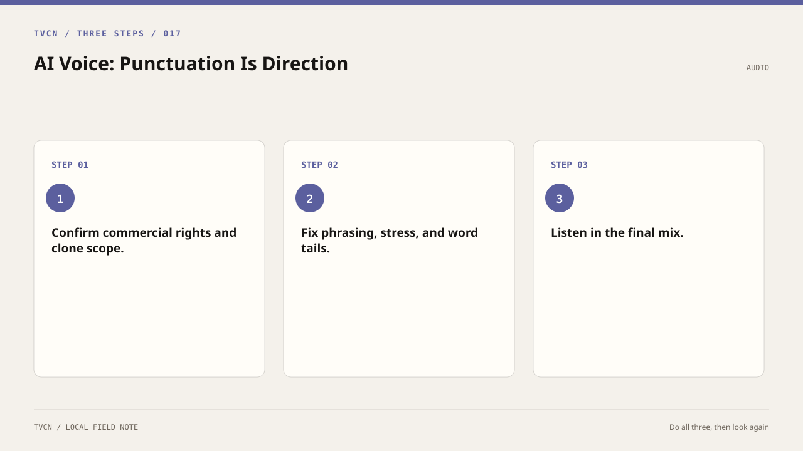

Put pauses, stress, and sentence breaks into the script before choosing a voice; timbre cannot fix bad phrasing.

<!-- DIAGRAM_START -->
<h2>Diagram</h2>
<figure>
  
  <figcaption>Do the three steps in order, then look again at the image or file.</figcaption>
</figure>
<!-- DIAGRAM_END -->
<h2>On set</h2>

Break the script into short sentences: 300 milliseconds at commas, 600 at periods. Write numbers out and expand abbreviations before generating.

<h2>Do this</h2>

AI voice starts with phrasing, stress, and pauses in the text, then voice selection; a voice cannot fix bad phrasing.
<ol><li>Break lines into short sentences, pausing 300 ms at commas and 600 ms at periods.</li><li>Write numbers in words, expand abbreviations, and mark stress on key words.</li><li>Play it on a phone speaker and check sibilance, tails, and stress.</li></ol>
<h2>Avoid</h2>

Do not judge on headphones alone; phone speakers expose sibilance and tails.

<h2>Check</h2>
<ul><li>Comma and period pauses are audible and sentences do not run together.</li><li>Numbers and abbreviations read correctly and stress lands on key words.</li><li>On a phone speaker, sibilance is not harsh, tails are not swallowed, and stress is right.</li></ul>
