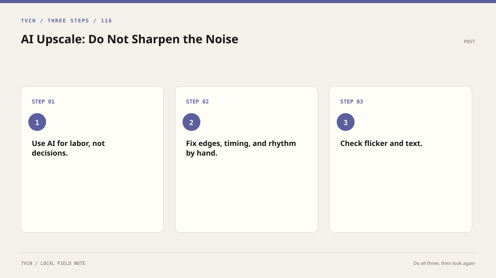

Check noise and edges before upscaling. Turning noise into detail is the most common fake sharpness.

<!-- DIAGRAM_START -->
<h2>Diagram</h2>
<figure>
  
  <figcaption>Do the three steps in order, then look again at the image or file.</figcaption>
</figure>
<!-- DIAGRAM_END -->
<h2>On set</h2>

Check noise at 50 percent, then edges at 200. If noise becomes detail, lower sharpening or change the model.

<h2>Do this</h2>

AI upscaling starts with noise and edges; turning noise into detail is the common fake sharpness.
<ol><li>View at 50 percent and inspect noise.</li><li>View at 200 percent and check edges for noise-as-texture.</li><li>If noise becomes detail, lower sharpening or change models.</li></ol>
<h2>Avoid</h2>

Do not max sharpening for clarity; amplified noise makes the image dirtier.

<h2>Check</h2>
<ul><li>At 50 percent, noise does not become fake grain texture.</li><li>At 200 percent, edges are clean with no halo or jaggies.</li><li>Side by side with the original, sharpness comes from edges, not noise.</li></ul>
