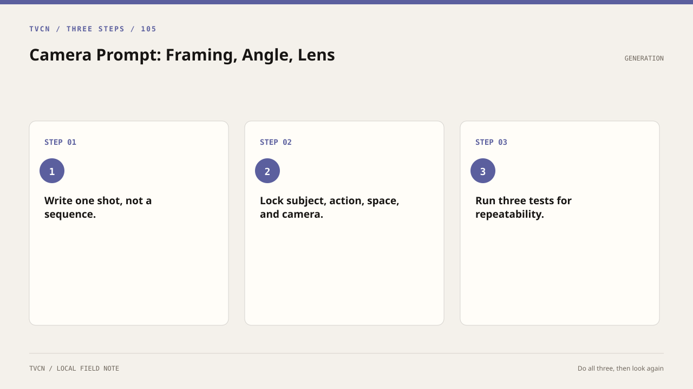

Camera prompts need framing, angle, and lens. Without them, the model guesses.

<!-- DIAGRAM_START -->
<h2>Diagram</h2>
<figure>
  
  <figcaption>Do the three steps in order, then look again at the image or file.</figcaption>
</figure>
<!-- DIAGRAM_END -->
<h2>On set</h2>

Write medium shot, eye level, 35mm, subject on the right third, then add motion. Keep shot size and focal length separate.

<h2>Do this</h2>

A camera prompt states size, angle, and lens; without them the model guesses.
<ol><li>Write medium shot, eye level, 35mm.</li><li>Place the subject in the right third and add one movement.</li><li>Keep size and lens separate; do not merge them into an adjective.</li></ol>
<h2>Avoid</h2>

Do not write only “cinematic camera”; missing size, angle, or lens makes the model guess.

<h2>Check</h2>
<ul><li>The prompt separately names size, angle, and lens.</li><li>Subject placement is a specific third, not “nice composition.”</li><li>The output matches medium shot, eye level, and a 35mm view.</li></ul>
