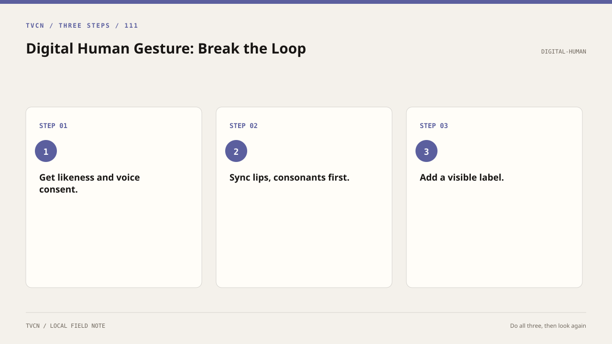

Break the gesture loop every fifteen seconds: shift weight or take the hands out of frame.

<!-- DIAGRAM_START -->
<h2>Diagram</h2>
<figure>
  
  <figcaption>Do the three steps in order, then look again at the image or file.</figcaption>
</figure>
<!-- DIAGRAM_END -->
<h2>On set</h2>

Design one action every fifteen seconds: pick up a cup, turn, leave frame. Do not let the hands repeat the same swing.

<h2>Do this</h2>

Digital-human gestures fail when they loop; change weight every fifteen seconds or take the hands out of frame.
<ol><li>Design one action every fifteen seconds: pick up a cup, turn, leave frame.</li><li>Do not let the hands repeat the same swing in front of the body.</li><li>Watch hands and weight on playback; if it loops, change the action.</li></ol>
<h2>Avoid</h2>

Do not keep the avatar on one weight and swinging; the loop gives it away.

<h2>Check</h2>
<ul><li>Weight or action changes every fifteen seconds instead of looping one pose.</li><li>The hands leave frame or touch an object at least once.</li><li>Ten seconds of watching the hands shows no repeated swing.</li></ul>
