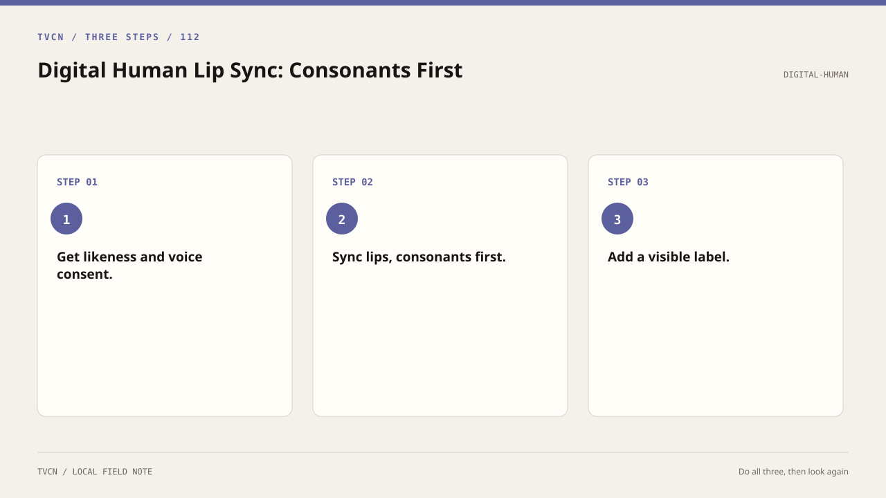

Align consonants first, especially p, b, m. Small vowel drift is tolerable.

<!-- DIAGRAM_START -->
<h2>Diagram</h2>
<figure>
  
  <figcaption>Do the three steps in order, then look again at the image or file.</figcaption>
</figure>
<!-- DIAGRAM_END -->
<h2>On set</h2>

Match p, b, and m first, then vowels. One frame of lip drift makes the voice feel outside the picture.

<h2>Do this</h2>

Digital-human lipsync starts with consonants, especially p, b, and m; small vowel drift is tolerable.
<ol><li>Align p, b, and m first.</li><li>Then check vowels and pauses.</li><li>If a frame is off, regenerate that sentence only, not the whole take.</li></ol>
<h2>Avoid</h2>

Do not start with vowels; if plosives are off, the voice feels detached from the face.

<h2>Check</h2>
<ul><li>The lip closure on p, b, and m matches the audio frames.</li><li>Vowels and pauses show no obvious lead or lag.</li><li>Only the problem sentence is regenerated, not the whole take.</li></ul>
