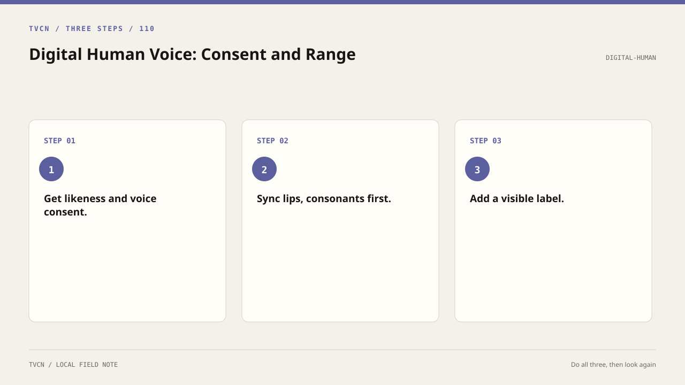

Get consent and define the range before cloning a voice. Capability is not permission.

<!-- DIAGRAM_START -->
<h2>Diagram</h2>
<figure>
  
  <figcaption>Do the three steps in order, then look again at the image or file.</figcaption>
</figure>
<!-- DIAGRAM_END -->
<h2>On set</h2>

The permission says whose voice, where it is used, for how long, and whether retraining is allowed. No written permission, no clone.

<h2>Do this</h2>

Digital-human voice starts with permission and scope; being able to clone does not mean you may.
<ol><li>The license states whose voice, where used, for how long, and whether retraining is allowed.</li><li>No written permission means no clone.</li><li>Label AI voice in the opening and description.</li></ol>
<h2>Avoid</h2>

Do not present generated lines as a real quote; that is fabrication, not voice-over.

<h2>Check</h2>
<ul><li>The license covers voice identity, use, term, and retraining.</li><li>No voice is cloned or used without written permission.</li><li>AI voice is labeled in both the opening and description.</li></ul>
