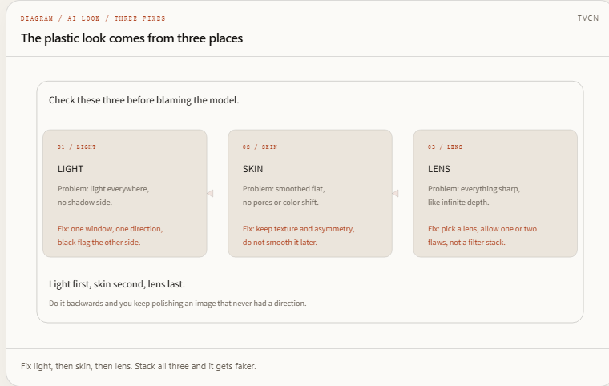

<!-- DIAGRAM_START -->
## Diagram

<figure>
  
  <figcaption>Fix light, then skin, then lens. Stack all three and it gets faker.</figcaption>
</figure>
<!-- DIAGRAM_END -->

The most common AI light comes from everywhere: no shadow on the face, no shadow under the nose, background as bright as the subject. A real room usually has one or two sources and a lot of bounce.

## Does the light have a direction?

Name one window, one lamp, or one reflector, then let the rest fall off. To kill the plastic look, add a black flag on the other side. A shadow with something in it makes a face stand.

Skip “cinematic lighting”; write “hard window light from the left, deep shadow on the right, background one stop down.”

## Skin that is too clean reads fake

Real skin has pores, fine hair, color variation, and asymmetry. AI often irons the face into an even film, losing the transitions around the nose and eyes.

Ask for “visible skin texture, pores, slight asymmetry, no beauty retouch” at generation time. It does more than adding noise later. If the image is already made, do not reach for skin smoothing. Add a little grain, pull the highlights down, and let the cheekbone and jaw keep a real light-dark transition.

## A perfect lens has no human trace

Real lenses distort, vignette, flare, disperse color, and fall out of focus. AI often renders everything sharp and every edge clean, like an infinite-depth render.

Pick a focal length and an aperture, then allow one or two imperfections: slight vignetting, soft highlight edges, a foreground and background that actually fall away. Do not stack every flaw. One or two per lens is enough; more becomes a filter.

## Checks

- You can point to the key direction and the shadow side.
- Skin keeps texture instead of being smoothed flat.
- The lens has one or two imperfections, not a stack of filters.

<!-- DEEP_DIVE_START -->
## Deep dive

<strong>About 8 minutes.</strong> The “AI look” is not a filter. It is three things being too complete at once: light with no direction, skin with no life, and a lens with no flaws.

### Plastic comes from an image with no choices

In a real room, a cinematographer must choose: expose for the face or the window, keep the background bright or dark, leave one side in shadow. AI often makes the opposite choice: face and background equally bright, left and right equally lit, near and far equally sharp. With no trade-off, the eye has nowhere to land, and the brain calls it fake.

The first step is not adding grain. It is removing information: turn off half the lights, drop the background a stop, let one side of the face fall into shadow. The audience should see that someone decided this frame, not that a model filled it. Shadow creates space; choice creates photography.

### Light: one key, one shadow, one contact shadow

Name one key source: a window on the left, a lamp upper right, a sign behind the subject. Name one shadow: flag the right side down two stops, or leave the corner lamp off. Then add contact shadows: under the chin and neck, under the cup on the table, where the body meets the chair. Contact points need darkness, or the person looks pasted in.

Do not write “soft cinematic light.” Write “hard window light from the left, deep shadow on the right cheek, background one stop down, contact shadow under the table edge.” If you want soft, write “north-facing window, overcast, no direct sun,” not “soft light.” Softness comes from source size and distance, not adjectives.

### Skin: texture, color variation, oil, asymmetry

Real skin is not an even film. Pores on the nose, fine lines under the eyes, slight color variation on the cheekbones, oil on the forehead, and asymmetry between left and right. AI smooths these “flaws” away by default, and the face turns to plastic. Write “keep pores and fine lines, slight color variation, natural forehead oil, asymmetric left and right, no beauty retouch.”

If the image already exists, do not rescue it with smoothing. Add grain, pull highlights down, restore the transition around the nose and eyes. If the face still reads as a mask, move to a wider shot so the face is not half the frame. Audiences spot fakes in close-up; they believe people in medium shots.

### Lens: focal length, aperture, distortion, vignette, breathing

Real lenses have character: wide angles widen noses, long lenses compress space, fast apertures soften ears, older glass vignettes and fringes. AI often delivers a perfect lens: sharp everywhere, clean to the corners, like an infinite-depth render. Choose focal length and aperture first, then allow one or two flaws.

Pick one or two traits per shot: slight vignette, foreground falloff, soft highlight edges, a little stretch at the wide edges. Add all of them and it becomes a filter; add none and it stays plastic. More important is consistency: one focal length and one flaw per scene, so the audience feels one camera shot it, not one model per image.

### Material and contact: give objects weight

Plastic is not only in the face. Cloth folds without gravity, table reflections without direction, a hand holding a cup with no contact shadow, hair edges like cut paper. All of it reads fake. Name the material: cotton, wool, brushed metal, wet glass. Name the contact: fingers pressing the cup, a shadow under the cup, a collar pressing the collarbone.

Hands break first. Instead of repairing fingers, change the framing: keep hands out of frame, give them an object that hides the joints, or show only a small part. The audience does not need ten fingers; it needs to believe the hand is exerting force. Material truth comes from force and contact, not from more texture words.

### Three steps: light, then skin, then lens

Do not change every parameter at once. Step one, light only: direction, shadow, contact. Run three and pick the one where the face sits in space. Step two, skin only: texture, color variation, oil, asymmetry. Run three more. Step three, lens only: choose focal length, add one flaw, unify the film.

Ask the same question at every step: is there one imperfect but believable decision in this frame? If all three areas are too complete, return to light. If the light is right and the face is still fake, widen the shot. The goal is not “unrecognizable as AI.” It is “someone made choices here.”

### Ten anti-AI-look checks
<ul><li>Light has one direction</li><li>Background one stop below the face</li><li>One side of the face in real shadow</li><li>Contact shadow under chin and neck</li><li>Contact shadow under cup on table</li><li>Pores and fine lines kept</li><li>Slight color variation and oil allowed</li><li>Left and right not perfectly symmetric</li><li>One or two lens flaws only</li><li>Focal length and flaw consistent across the film</li></ul>
Removing the AI look is not making the image dirty. It is making it less complete.

<!-- DEEP_DIVE_END -->
