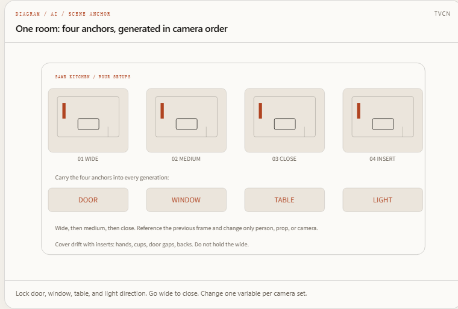

<!-- DIAGRAM_START -->
## Diagram

<figure>
  
  <figcaption>Lock door, window, table, and light direction. Go wide to close. Change one variable per camera set.</figcaption>
</figure>
<!-- DIAGRAM_END -->

The expensive part of AI is not generation. It is the same room quietly changing direction by the third shot.

## Build a scene anchor before stacking adjectives

Before writing a prompt, draw the crudest floor plan: where the door is, where the window is, where the table sits, which side the light comes from. Then lock it in one sentence: kitchen, window left, counter right, fridge behind the door, warm ceiling light. Carry that sentence into every shot.

Adjectives lie. “A cozy kitchen” grows a different kitchen every time. “Window left, table right” is something you can check. A scene anchor is geography, not mood.

Then shoot an empty plate: no person, no action, just the room. It is the master for every later shot, and the one thing you can return to when drift shows up.

## Generate in camera order, not script order

Most people generate in script order: close-up, reverse, then a wide at the end. Every shot is guessing what the room looks like. Build the wide first, then the medium, then inserts. Later shots reference earlier frames, so the space inherits itself.

Change one variable per new shot: person, prop, or camera. Change three at once and you cannot tell which one caused the drift. Keep every reference, seed, and the anchor sentence in one folder.

If the series moves in time, change the light before changing the house. Day can become night; the window and door cannot move.

## When drift happens, leave the edit a way out

AI scenes will drift. The window flips, the table moves half a meter, the picture on the wall changes. Do not plan to fix it in post. Prepare cover shots while generating: hands, cups, a door gap, a back, footsteps. If the audience never sees the whole room, they cannot see the change.

Hide the drift inside an action: opening a door, sitting down, turning, handing something over. Action takes the attention and the spatial error passes. But do not use this to cover story holes; it fixes geography, not drama.

## Checks

- You can write the four anchors: door, window, table, light direction.
- Wide before close, and every new shot references the last frame plus the anchor.
- At least three inserts are ready to cover a drift.
