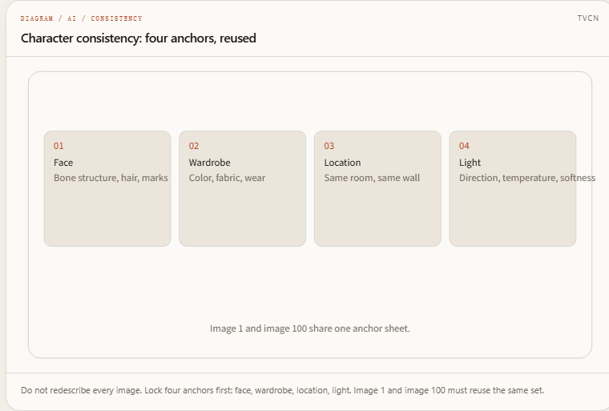

<!-- DIAGRAM_START -->
## Diagram

<figure>
  
  <figcaption>Do not redescribe every image. Lock four anchors first: face, wardrobe, location, light. Image 1 and image 100 must reuse the same set.</figcaption>
</figure>
<!-- DIAGRAM_END -->

The expensive part of AI is not generation; it is inconsistency. Lock the face, wardrobe, and set into reusable anchors before scaling.

## Five fixed features

Write five features that will not change: age, hair, wardrobe, build, and one memory point (a scar, glasses, an old watch). Do not write “handsome” or “kind”; those are not reproducible.

Every feature must be visible. The memory point is how the audience recognizes the character next time, and how the model holds the same face.

## Keep one reference image

Too many references fight each other. Choose one front or three-quarter face with even light and a clean background as the only face reference.

Keep wardrobe and set references separate. Lock face, clothes, and space independently so a change in one does not break the others.

## Log the parameters

Log model version, seed, prompt, reference ID, and resolution for every generation. Put them in one table and reuse them for the next shot.

If one image works, reproduce it before changing action. Do not change face, wardrobe, and camera in the same round; you will not know which variable did the work.

## Three checks

- The character card has five fixed, visible features.
- Three images read as the same person.
- The log can reproduce the same output.

<!-- DEEP_DIVE_START -->
## Deep dive

<strong>About 7 minutes.</strong> Consistency is not every image looking alike. It is the audience putting three images together and still believing it is the same person and room.

### Build a character sheet

One front, one side, one medium shot. Write down hair, brows, nose, face shape, skin, age, fixed clothing. Carry all three references every generation, not one.

Add three “must not change” items: a mole, an earring, a hair part. Three anchors give the audience something to hold.

### Lock the room before the person

Generate three empty plates of the same room: wide, medium, reverse. Confirm walls, window, table, lamp positions, then put the person in. If the room changes, a stable person still looks like a different production.

Write a room sheet: where the door is, the window, the light side, what is on the table. Check it every generation.

### Shot order affects consistency

Wide first for relationships, medium for action, close last for emotion. Do not make the close first and ask the wide to guess the space. The close breaks most; save it for last.

Generate shots from the same scene in one session with the same parameters and references. A few days later, both the model and your memory have changed.

### Five-minute drill: three images, one person

With one character sheet, generate three: front medium, side, hand action. Change only the camera, not clothing or light. Put them side by side and find the first difference.

That difference becomes the next “must not change” anchor. Do not fix it in post; change the reference and prompt first.

### When consistency holds

Consistency holds when a stranger sees three images and knows it is the same person; the person in the wide matches the close in clothing, hair, and light direction; a different shot order still works. Three pass.

Looking good in one image is not consistency. Consistency is being believable across shots.

### Ten consistency checks
<ul><li>Front, side, medium character sheet</li><li>Hair, brows, nose, face written</li><li>Three must-not-change anchors</li><li>Three empty plates lock the room</li><li>Room sheet: door, window, light</li><li>Wide, medium, close order</li><li>Close shot last</li><li>Same scene in one session</li><li>Same parameters and references</li><li>Stranger recognizes the same person</li></ul>
Consistency is not making three images look the same. It is making three images make sense in space and time.

<!-- DEEP_DIVE_END -->
