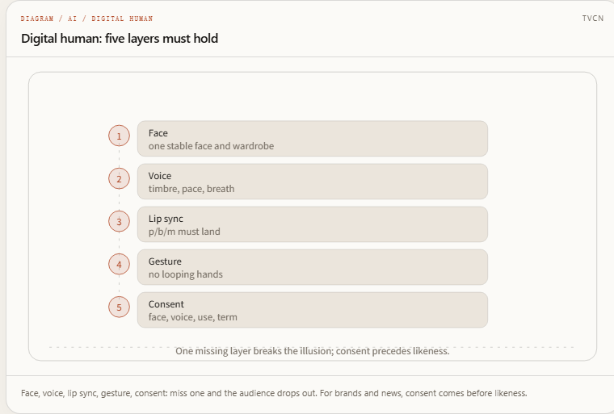

<!-- DIAGRAM_START -->
## Diagram

<figure>
  
  <figcaption>Face, voice, lip sync, gesture, consent: miss one and the audience drops out. For brands and news, consent comes before likeness.</figcaption>
</figure>
<!-- DIAGRAM_END -->

## Consent comes first

Cloning a face or voice needs written consent: use, term, platforms, and whether it can be altered. An unauthorized likeness is not a technical issue; it is a legal one.

Brand endorsement, news anchoring, and commentary by real people carry the highest risk. Knowledge explainers, internal training, and fictional characters are lower, but still need disclosure.

## Lip sync and gesture decide trust

The audience watches the mouth, then the hands. Half a beat off on lip sync breaks the illusion; the same gesture three times reads as a machine. Align consonants first, then vary gesture.

A locked camera, medium shot, and clean background work better than full-body action. Digital humans do not fear simplicity; they fear too much movement.

## Disclosure is information, not a disclaimer

Put “AI-generated” or “digital human” at the head, in the description, or as a corner label. Make it visible, not buried at the end of a collapsed description.

If the digital human speaks for a real person, confirm the words were actually said, or label it clearly as simulated. Never present generated lines as quotes.

## Three checks

- Signed consent covers likeness and voice.
- Lip sync holds and gestures do not mechanically repeat.
- A clear AI label appears on screen or in the description.
