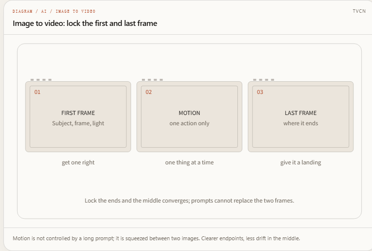

<!-- DIAGRAM_START -->
## Diagram

<figure>
  
  <figcaption>Motion is not controlled by a long prompt; it is squeezed between two images. Clearer endpoints, less drift in the middle.</figcaption>
</figure>
<!-- DIAGRAM_END -->

Get one image right, then make it move. The key is not a longer prompt; it is the first and last frame and the amount of motion.

## Image first, video second

Use an image model to lock composition, light, and character first. If the image is wrong, video only amplifies it. Leave room for motion in the first frame: space in front of the character, a prop within reach.

Do not generate motion from a frame that is already full. The model has nowhere to move the character, so the face distorts.

## First and last frame

If you can control first and last frames, do it: first frame is the start, last frame is the end. Put one action between them, such as “turn,” “set down the cup,” or “look up.”

Without last-frame control, prompt an action rather than an emotion: “she takes her hand out of her pocket,” not “she feels nervous.”

## Keep the motion small

One action per shot, three to five seconds. The bigger the motion, the more likely hands, faces, and backgrounds break. Generate small actions and build rhythm in the edit.

If a generation contains three steps and a push-in, it is usually unusable. Split it into two shots; the cut will be more stable.

## Three checks

- The first frame leaves room for motion.
- One generation contains one main action.
- First and last frames and prompt are logged.

<!-- DEEP_DIVE_START -->
## Deep dive

<strong>About 7 minutes.</strong> Image-to-video is not making a frame move. It is keeping the same subject the same person through time.

### Choose an image that can move

Clear subject, readable limbs, background that does not intersect the body, clear light direction. A frontal headshot is hard to move; a medium shot with a hand action is easier.

Do not start too high-resolution; too much detail makes the model jitter. Crop to the target ratio first so generation does not stretch it.

### Ask for small motion

Version one asks for one action: blink, turn the head, raise a hand, hair in wind. Do not combine walking, talking, and an orbit. More action, more face drift.

Write camera motion separately: locked, slow push, lateral move. Do not mix it into the character action. Keep the person first, the camera second.

### Use first/last frames and references

Give a last frame when possible so the model knows where to stop. Give three reference angles of the same person, not one.

After generation, check face, hands, and clothing edges first. If the face drifts, reduce motion; if hands break, change the pose. Do not fix structure with post face repair.

### Five-minute drill: three seconds, one action

Use a medium shot, generate three seconds with only “blink and turn the head slightly,” camera locked. Generate three times and pick the most stable face.

Then try “raise a hand” and compare which action breaks more. Write the result into the posing requirements for the next image.

### When the clip is cuttable

Cuttable means three seconds with a stable face, hands that do not intersect, clothing edges that do not jump, a background that does not melt, and motion matching the prompt. Five pass.

If one clearly fails, do not rescue it with speed ramps and crops. Return to the image and action, and generate a smaller motion.

### Check the hands again

Watch the hands frame by frame: extra fingers, fingers through cloth, sudden shortening. Hands break first in image-to-video. If they fail, change the action so the hands leave frame; do not hand it to post repair.

### Ten image-to-video checks
<ul><li>Clear subject, readable limbs</li><li>Background does not intersect body</li><li>Light direction clear</li><li>Crop to target ratio first</li><li>One action in version one</li><li>Camera motion written separately</li><li>Last frame if available</li><li>Three references of the same person</li><li>Check face, hands, clothing edges first</li><li>Face drift means less motion</li></ul>
The first rule of image-to-video: smaller motion is better than a changed face.

<!-- DEEP_DIVE_END -->
