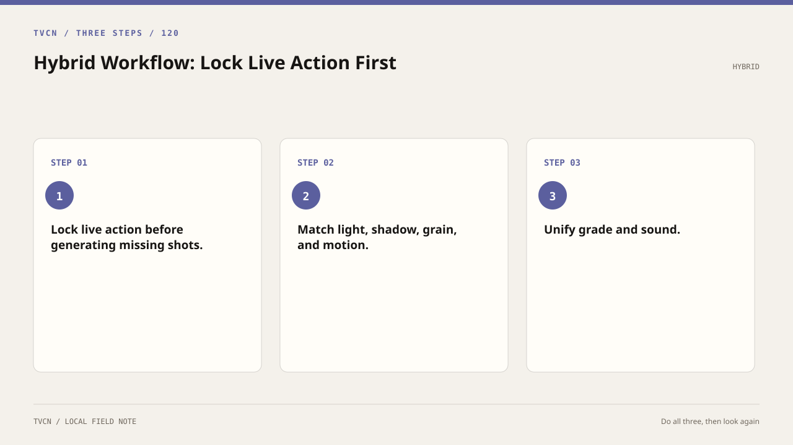

Lock live action before generating missing shots. Generate first and the light will never match.

<!-- DIAGRAM_START -->
<h2>Diagram</h2>
<figure>
  
  <figcaption>Do the three steps in order, then look again at the image or file.</figcaption>
</figure>
<!-- DIAGRAM_END -->
<h2>On set</h2>

Shoot the live-action master first and log camera, lens, and light position. Prompt the generated shots from those values, then match grain and grade.

<h2>Do this</h2>

Live-action plus AI locks the plate first, then generates missing shots; generating before the shoot guarantees a light mismatch.
<ol><li>Shoot the main plate and record camera, lens, and light positions.</li><li>Generate missing shots from those parameters.</li><li>Unify grain, grade, and sound, then check the seam.</li></ol>
<h2>Avoid</h2>

Do not generate before the shoot; the light will not match.

<h2>Check</h2>
<ul><li>The plate has complete camera, lens, and light notes.</li><li>Generated shots use those parameters, not a separate setup.</li><li>At the seam, light direction, grain, and motion match and the boundary disappears.</li></ul>
