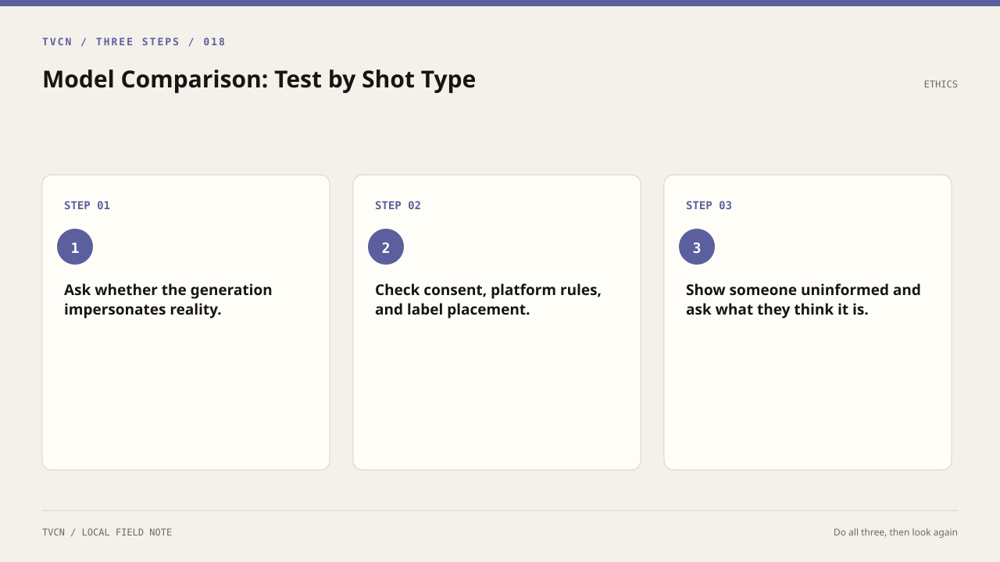

Do not compare leaderboards; test by shot type: face, hands, motion, text, long take.

<!-- DIAGRAM_START -->
<h2>Diagram</h2>
<figure>
  
  <figcaption>Do the three steps in order, then look again at the image or file.</figcaption>
</figure>
<!-- DIAGRAM_END -->
<h2>On set</h2>

Test five models with the same five-second prompt and reference image. Run each three times and score face, hands, text, and motion.

<h2>Do this</h2>

Model comparison is not a leaderboard; test the shot types you need: face, hands, motion, text, long take.
<ol><li>Use the same five-second prompt and reference image across five models.</li><li>Run each model three times and log face, hands, text, and motion.</li><li>Score against your project weights, not the overall ranking.</li></ol>
<h2>Avoid</h2>

Do not choose by overall rank; your shot type is the scorecard.

<h2>Check</h2>
<ul><li>All five models use the same prompt and same reference image.</li><li>Each model runs three times with face, hands, text, and motion logged.</li><li>Final ranking follows project weights, not the leaderboard.</li></ul>
