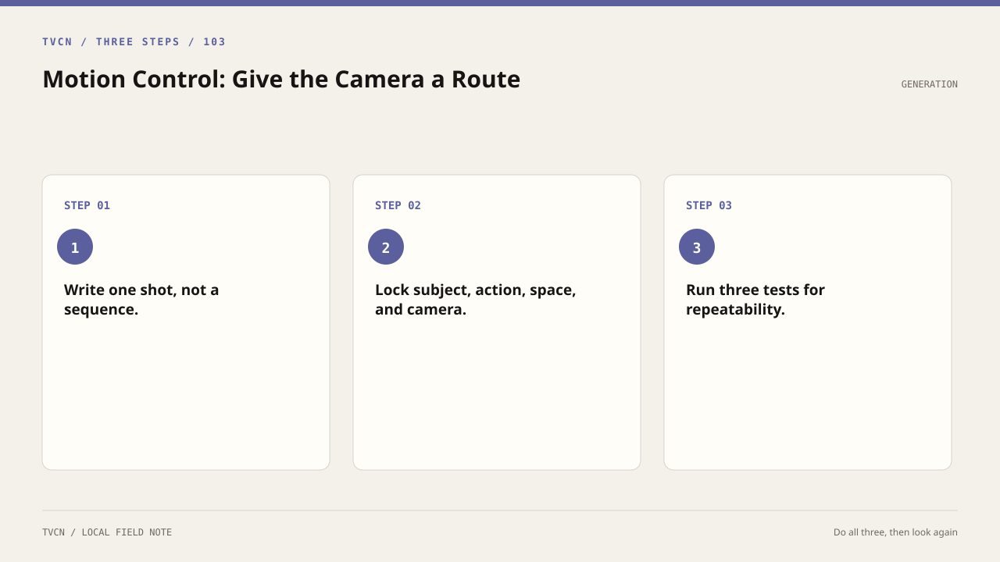

Give the camera a route: where it starts, what it passes, where it stops. "Camera moves" says nothing.

<!-- DIAGRAM_START -->
<h2>Diagram</h2>
<figure>
  
  <figcaption>Do the three steps in order, then look again at the image or file.</figcaption>
</figure>
<!-- DIAGRAM_END -->
<h2>On set</h2>

Write the camera path: push from the door to one meter from the table, hold two seconds. Use a reference video or keyframes; do not just say orbit.

<h2>Do this</h2>

Motion control starts with a camera path: where it starts, what it passes, where it stops. “Camera moves” says nothing.
<ol><li>Write the path: push from the door to one meter from the table, hold two seconds.</li><li>Control with a reference video or keyframes, not just “orbit.”</li><li>Run three times to confirm the path repeats before changing a variable.</li></ol>
<h2>Avoid</h2>

Do not write only “orbit” or “push”; without start and stop, the model wanders.

<h2>Check</h2>
<ul><li>The prompt states start, path, and stop and can be drawn as a line.</li><li>All three outputs reach the same endpoint without changing direction mid-shot.</li><li>When speed or lens changes, the path itself still repeats.</li></ul>
