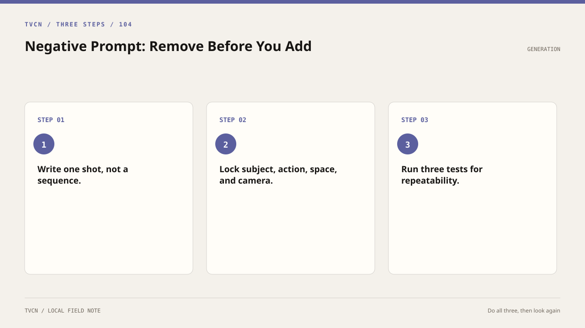

Remove what ruins the frame first: flicker, extra fingers, garbled text, face morphing.

<!-- DIAGRAM_START -->
<h2>Diagram</h2>
<figure>
  
  <figcaption>Do the three steps in order, then look again at the image or file.</figcaption>
</figure>
<!-- DIAGRAM_END -->
<h2>On set</h2>

List four categories: flicker, extra fingers, garbled text, warped faces. One negative term per category; do not stack fifty.

<h2>Do this</h2>

Negative prompts remove what breaks the image first: flicker, extra fingers, garbled text, face warping.
<ol><li>List four classes: flicker, fingers, text, face.</li><li>Write one negative term per class, not fifty.</li><li>Run three times and confirm the term actually reduces that problem.</li></ol>
<h2>Avoid</h2>

Do not stack a long negative list; conflicting constraints make the model less stable.

<h2>Check</h2>
<ul><li>Negative terms cover four problem classes and each maps to a visible error.</li><li>The problem visibly decreases across three outputs, not just in your head.</li><li>Remove one term and the problem returns, proving it worked.</li></ul>
