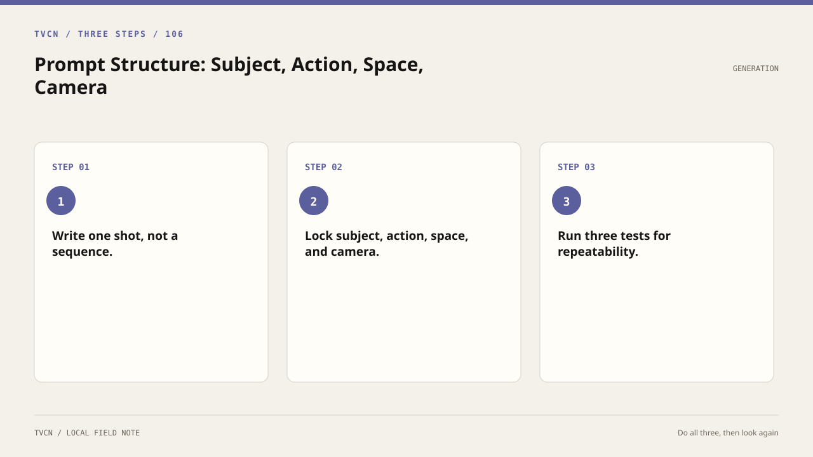

Build prompts in four parts: who, doing what, where, camera. Stable order gives stable output.

<!-- DIAGRAM_START -->
<h2>Diagram</h2>
<figure>
  
  <figcaption>Do the three steps in order, then look again at the image or file.</figcaption>
</figure>
<!-- DIAGRAM_END -->
<h2>On set</h2>

Keep four lines: who the subject is, what they do, where they are, and how the camera sits. Change one word per test.

<h2>Do this</h2>

Write prompts in four parts: who, doing what, where, and how the camera sits. Stable order gives stable results.
<ol><li>Fix four lines: subject, action, environment, camera.</li><li>Change one word per line per test.</li><li>Keep the order; do not put environment before action.</li></ol>
<h2>Avoid</h2>

Do not blend four parts into prose; the model cannot tell which word controls action or camera.

<h2>Check</h2>
<ul><li>The prompt splits into subject, action, environment, and camera in fixed order.</li><li>Each test changes one word in one line only.</li><li>Changing the order visibly hurts the result, proving the structure matters.</li></ul>

<!-- DEEP_DIVE_START -->
## Deep dive

<strong>About 7 minutes.</strong> A prompt is not a spell. It splits the image into subject, action, camera, light, and style, and changes one thing at a time.

### Write the five things

Who the subject is, what they do, where the camera is, where light comes from, what texture the image has. Missing one and the model guesses; fixing a guess is luck.

Write concrete nouns and actions before adjectives. Do not start with “cinematic, premium, moody.” Those words have no direction; the model gives you an average.

### Change one thing at a time

Version one fixes subject and action; version two changes only the camera; version three only the light. Change three things and a bad result tells you nothing.

Save every prompt and output with a version number. After three rounds, you know which word the model responds to.

### Write with camera language

“Low angle, 35mm, subject on the right, compressed background” does more than “beautiful.” “Side backlight, hard shadow, warm temperature” does more than “mood.”

For motion, write start and end: close-up on hands pulling to a medium shot, or subject walks left to right. Do not write only “camera movement.”

### Five-minute drill: five-slot prompt

Write a five-slot table: subject, action, camera, light, style. One line each, under fifteen words. Generate one image, then change only the camera slot and generate a second.

Compare side by side. Is the difference what you asked for? If not, change that slot; do not rewrite the paragraph.

### When a prompt is usable

A prompt is usable when three runs hold subject, action, and composition direction; changing one slot changes the output as expected; another person using the same table gets a similar result. Three pass.

One good image is a lucky draw. Three stable images are a method.

### Check the subject again

Cover the five-slot table and look only at the image: is the subject recognizable at first glance, and can the action be said in one line? If either is vague, fix subject and action before adding style words. A prompt should be understandable first, likable second.

### Ten prompt checks
<ul><li>Subject named</li><li>Action named</li><li>Camera named</li><li>Light direction named</li><li>Texture named</li><li>Nouns and actions before adjectives</li><li>One slot changed per round</li><li>Prompt and output saved per version</li><li>Motion has start and end</li><li>Three stable runs before usable</li></ul>
A prompt is judged not by one lucky draw, but by whether changing one slot changes the result as expected.

<!-- DEEP_DIVE_END -->
