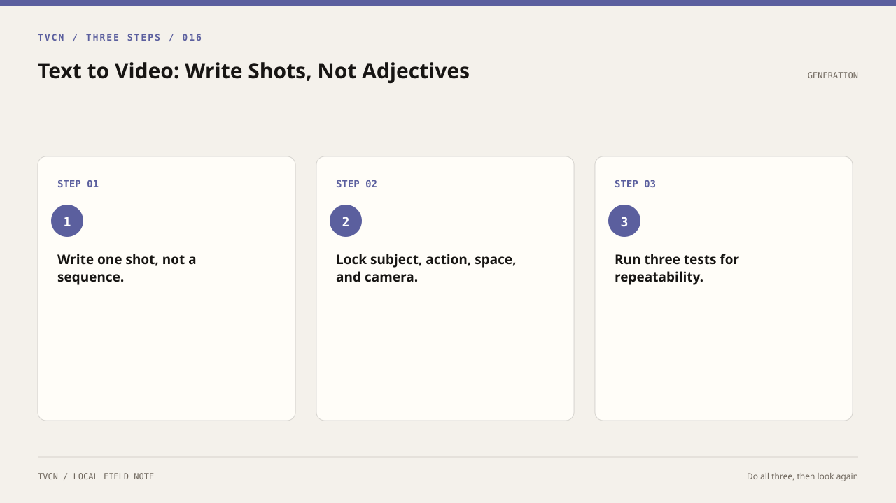

Write shots and actions, not "cinematic, epic"; the model cannot act on adjectives.

<!-- DIAGRAM_START -->
<h2>Diagram</h2>
<figure>
  
  <figcaption>Do the three steps in order, then look again at the image or file.</figcaption>
</figure>
<!-- DIAGRAM_END -->
<h2>On set</h2>

Write one three-second shot: a person walks from frame left to frame right, background still. Test it three times changing one variable only, such as speed, lens, or light.

<h2>Do this</h2>

Text-to-video starts with a shot and an action, not “cinematic” or “epic”; the model cannot hear adjectives.
<ol><li>Write one three-second shot: a person walks left to right while the background stays still.</li><li>Lock subject, action, environment, size, angle, and lens.</li><li>Run three times, changing one variable each time: speed, camera, or light.</li></ol>
<h2>Avoid</h2>

Do not stack adjectives; the model only responds to visible nouns and actions.

<h2>Check</h2>
<ul><li>All three outputs are the same three-second shot with stable subject and background.</li><li>Only one variable changes per run and you can name what each change did.</li><li>The prompt contains no empty adjectives like cinematic or epic.</li></ul>

<!-- DEEP_DIVE_START -->
## Deep dive

<strong>About 7 minutes.</strong> The real difficulty of text-to-video is not generating a beautiful image. It is making the same shot three times and still recognizing it. Learn to write the shot before you write the style.

### Translate feeling into five visible items

A usable prompt states at least five things: who the subject is, what they are doing, where they are, where the camera is, and how the shot ends. Do not write “loneliness.” Write “a person seated by the door of the last train, hands on knees, body leaning forward as the train arrives.”

Adjectives describe your feeling; nouns and verbs describe the image. Delete “cinematic” and write “35mm, low angle, cold light through the window, warm light inside the carriage.” Delete “premium” and write “one glass and one key on the table.” A model does not shoot better because the words are prettier; it guesses less because the information is specific.

### First frame, action, last frame: three images for one shot

Before generating, draw three images in your head or on paper: what the audience sees first, which single action happens, where the shot lands. Allow only one major change between the three. A person walking left to right is one change; turning, opening a door, zooming, and changing light at the same time is four, and the model will lose some.

If the tool supports start and end frames, use them to lock composition and let the motion fill the middle. If not, lock the camera and finish with one action. Three to five seconds is the stable range. Longer means split the shot or accept subject drift. Do not test a model's memory with a “one-take” unless you plan to repair every frame.

### Control variables: change one thing at a time

Treat testing as an experiment, not a lottery. Round one: fix subject, wardrobe, space, camera, and light direction; change only action speed. Round two: change only camera height. Round three: change only light direction. Run three generations per round and note which one repeats. You are not looking for “the best-looking one”; you are looking for “the most stable set.”

Keep a three-column log: what changed, what changed in the result, keep or discard next time. Without a log, by the third generation you only remember “there was a good version,” and you can never find it again. Reproducibility matters more than one stunning frame, because a film needs ten shots that cut together, not a poster.

### Failure types: drifting subject, fake action, chaotic camera, plastic texture

Drifting subject: face, wardrobe, and age change within the shot. Reduce action and camera movement, then shorten the duration. If it still drifts, turn the person into a back, a profile, or a detail; do not ask the audience to stare at a face for four seconds. Fake action: walking slides, a reaching hand has no weight. Break the action into preparation, event, and recovery; keep only the event, or finish it off-screen.

Chaotic camera: the model invents push-ins and pans. Write “locked-off, no camera movement” and create rhythm with movement inside the frame. Plastic texture: light has no direction, skin has no texture, the lens has no flaws. Return to light, skin, and lens; do not hide it with a filter. Fix one category at a time, then run three comparisons.

### From clip to sequence: matching is the finish line

A watchable clip is not necessarily editable. Check four things: screen direction, light direction, wardrobe and prop continuity, and whether the cut in shot size feels right. If the person walks right to left in shot A, they cannot walk left to right in shot B. If window light hits the left cheek in A, it cannot switch to the right cheek in B.

Leave two seconds of handle at the head and tail of every shot. For important transitions, generate an overlap frame so both shots share a reference. Do not expect grading to save a wrong direction. The audience will not name it, but they will feel out of place. A sequence is finished when the story is clear with the sound off.

### Ten text-to-video checks
<ul><li>One prompt, one shot</li><li>Subject, action, space, camera, ending stated</li><li>Delete invisible adjectives</li><li>Draw first and last frames first</li><li>Three to five seconds is stable</li><li>Change one variable at a time</li><li>Run three and log each round</li><li>If subject drifts, cut action and time</li><li>Write locked-off camera</li><li>Watch the sequence muted</li></ul>
Text-to-video does not ask the model to think for you. It writes the shot so the model has nothing to guess.

<!-- DEEP_DIVE_END -->
