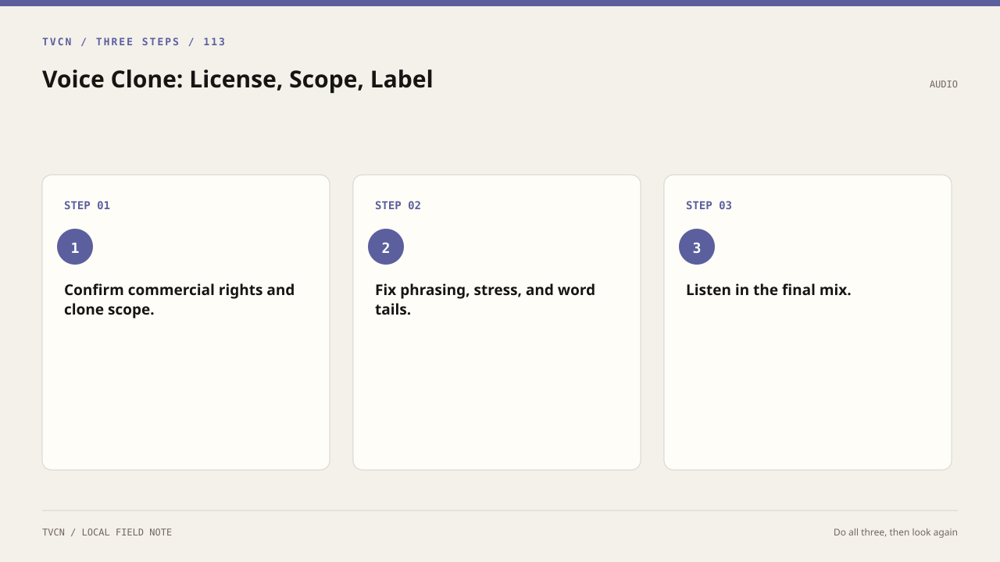

State license, term, platforms, and whether retraining is allowed; label it in the credits.

<!-- DIAGRAM_START -->
<h2>Diagram</h2>
<figure>
  
  <figcaption>Do the three steps in order, then look again at the image or file.</figcaption>
</figure>
<!-- DIAGRAM_END -->
<h2>On set</h2>

The permission names platforms, term, and whether retraining is allowed. Label AI voice in the credits and description.

<h2>Do this</h2>

Voice cloning states permission, term, platforms, and whether retraining is allowed; credit it at the end.
<ol><li>The license covers platforms, term, and retraining.</li><li>Label AI voice at the end and in the description.</li><li>Keep the license and generation log with the delivery archive.</li></ol>
<h2>Avoid</h2>

Do not confuse “can clone” with “can use commercially”; if scope is unclear, do not.

<h2>Check</h2>
<ul><li>The license states platforms, term, and retraining.</li><li>AI voice is labeled at the end and in the description, not buried in small print.</li><li>The license and generation log are findable with the delivery.</li></ul>
