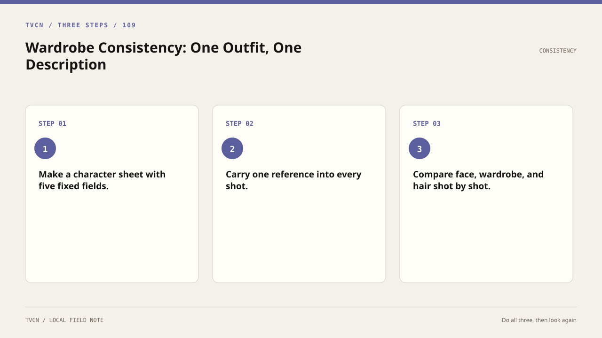

Wardrobe consistency needs a fixed description and reference, not the words "same person."

<!-- DIAGRAM_START -->
<h2>Diagram</h2>
<figure>
  
  <figcaption>Do the three steps in order, then look again at the image or file.</figcaption>
</figure>
<!-- DIAGRAM_END -->
<h2>On set</h2>

Describe color, fabric, collar, sleeves, and pattern. Crop the reference to the garment only; a face in the reference leaks into the model.

<h2>Do this</h2>

Wardrobe consistency comes from a fixed description and a clothing reference, not “same person.”
<ol><li>Describe five traits: color, material, collar, sleeves, pattern.</li><li>Crop the reference to clothes only, no face, so the model does not blend identity.</li><li>Compare collar and pattern per shot; if they drift, fix the description.</li></ol>
<h2>Avoid</h2>

Do not use a face reference to lock clothes; the model blends face and garment.

<h2>Check</h2>
<ul><li>The wardrobe description covers color, material, collar, sleeves, and pattern.</li><li>The reference shows clothes only with no face or background distraction.</li><li>Collar and pattern stay consistent; the garment does not change between shots.</li></ul>
