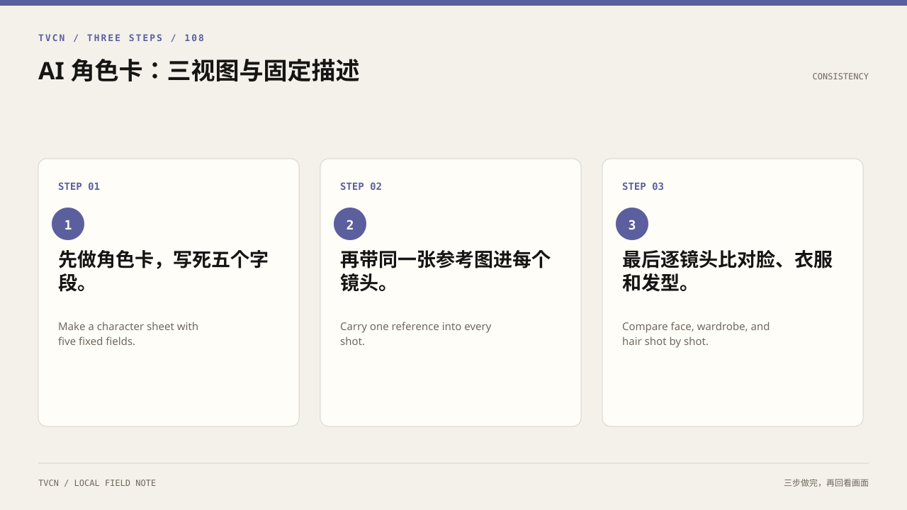

AI 角色卡固定脸型、年龄、发型、服装、气质五个字段，每次生成都带着走。

<!-- DIAGRAM_START -->
<h2>图解</h2>
<figure>
  
  <figcaption>把三步按顺序做完，再回看画面或文件。</figcaption>
</figure>
<!-- DIAGRAM_END -->
<h2>现场</h2>

角色卡写五个字段，每个字段一句固定描述；配三视图，生成时带同一张脸和同一段文字。

<h2>怎么做</h2>

AI 角色卡固定脸型、年龄、发型、服装、气质五个字段，每次生成都带着走。
<ol><li>角色卡写五个字段，每个字段一句固定描述。</li><li>配三视图，生成时带同一张脸和同一段文字。</li><li>逐镜头比对脸、衣服和发型，发现漂移就回到卡。</li></ol>
<h2>别踩</h2>

别指望“同一个人”四个字能锁住角色；模型没有记忆。

<h2>验收</h2>
<ul><li>角色卡五个字段都有一句固定描述，不是关键词堆。</li><li>每个镜头都带同一张三视图和同一段描述。</li><li>逐镜头比对脸、衣服、发型，三处都没有明显漂移。</li></ul>

<!-- DEEP_DIVE_START -->
## 深读

<strong>约 5 分钟。</strong> 角色卡不是审美描述，是一份能反复引用的通缉令。

### 角色卡五个固定字段

年龄、发型、服装、体型、记忆点，一项只写一个值。不要写“有点酷”，写“左眉有一道短疤”。描述越像通缉令，越能复用。

服装要写到颜色、材质、领口；同一场戏不要换。角色卡和场景卡分开存，不然改场景会顺手改脸。

### 三种笨办法

同一张参考图、同一个种子、同一个描述，三样一起用；少一样就会漂。需要正脸时用侧脸接，需要全身时用中景接，别让生成工具一次解决所有角度。

每十张做一次并排检查：把三视图和最近生成放在一张纸上，一眼能看出的差别，观众也能看出。

### 参考图不是越多越好

一张清楚的正面半身像，比十张角度不同的图更有用。参考图一多，模型会在它们之间折中，最后谁也不像。

需要侧面就单独生成侧面，再把它加进角色卡；不要把所有图一起丢进去。

### 角色漂移的三种症状

脸型变宽、发际线变高、衣服颜色变浅，是三种最早的漂移。不要等到眼睛坏了才重做。

每五镜做一次并排：第一镜、上一镜、当前镜。三张放在同一屏，差异一眼就能看见。

### 角色卡十项，少一项就会漂
<ul><li>年龄写一个具体数字</li><li>发型写长度、分缝、颜色</li><li>服装写颜色、材质、领口</li><li>体型写高矮和肩宽</li><li>记忆点写一道疤或一件配饰</li><li>正面参考图只要一张清楚的</li><li>侧面和背面单独生成再入库</li><li>角色卡和场景卡分开存</li><li>每五镜并排看第一镜、上一镜、当前镜</li><li>发现漂移就回第一镜重做</li></ul>
角色卡越像通缉令，越不容易漂。模糊的“气质”描述，最后都会变成另一张脸。每次换场景前重读一遍十项字段，漂移往往从你觉得自己记得开始。先读卡，再开生成。

<!-- DEEP_DIVE_END -->
