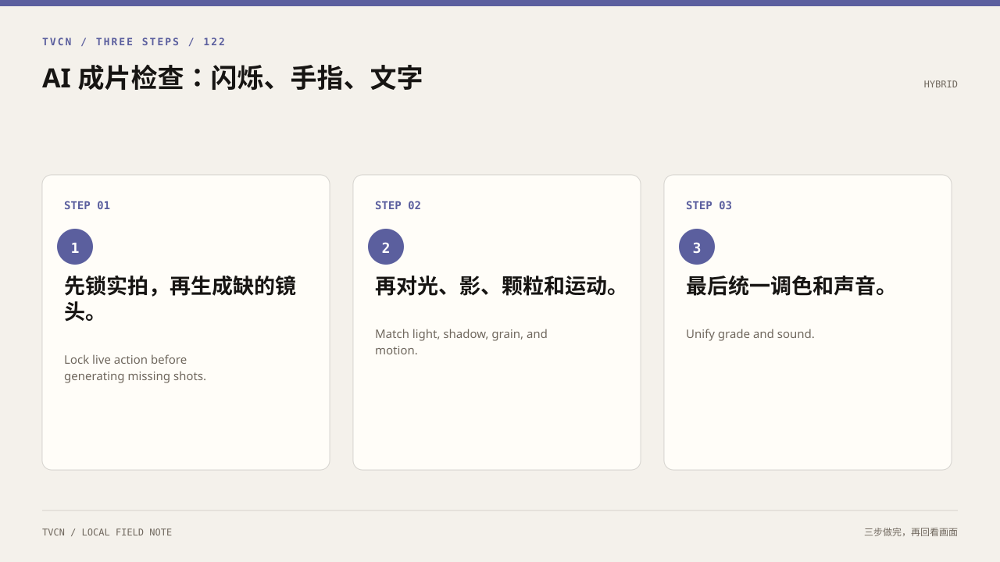

AI 成片检查先看闪烁、手指、文字和口型；这四样一崩，观众立刻出戏。

<!-- DIAGRAM_START -->
<h2>图解</h2>
<figure>
  
  <figcaption>把三步按顺序做完，再回看画面或文件。</figcaption>
</figure>
<!-- DIAGRAM_END -->
<h2>现场</h2>

逐帧看四样：闪烁、手指数量、画面文字、口型；每个镜头至少看两遍，一遍正常速度一遍逐帧。

<h2>怎么做</h2>

AI 成片检查先看闪烁、手指、文字和口型；这四样一崩，观众立刻出戏。
<ol><li>逐帧看四样：闪烁、手指数量、画面文字、口型。</li><li>每个镜头至少看两遍：正常速度和逐帧。</li><li>发现崩点标时间码，回退那一镜，不整片重生成。</li></ol>
<h2>别踩</h2>

别只用正常速度看一遍；闪烁和手指问题只在逐帧里出现。

<h2>验收</h2>
<ul><li>每个镜头都看了正常速度和逐帧两遍。</li><li>闪烁、手指、文字、口型四类问题都有记录。</li><li>崩点按时间码回退到具体镜头，没有整片重生成。</li></ul>
