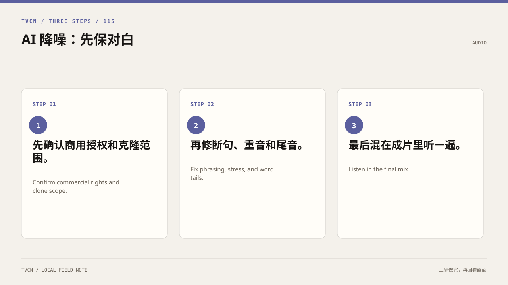

AI 降噪先保人声的齿音和尾音，别把句子修成机器人。

<!-- DIAGRAM_START -->
<h2>图解</h2>
<figure>
  
  <figcaption>把三步按顺序做完，再回看画面或文件。</figcaption>
</figure>
<!-- DIAGRAM_END -->
<h2>现场</h2>

先保留 2 到 4 kHz 的齿音和句尾；降噪后听 s 和 sh，如果变成 th，就退回一半。

<h2>怎么做</h2>

AI 降噪先保人声的齿音和尾音，别把句子修成机器人。
<ol><li>先保留 2 到 4 kHz 的齿音和句尾。</li><li>降噪后听 s 和 sh，如果变成 th，就退回一半。</li><li>在手机外放再听一遍，确认没有金属感。</li></ol>
<h2>别踩</h2>

别把降噪开到最大；齿音一没，人声就假。

<h2>验收</h2>
<ul><li>s 和 sh 仍然是齿音，没有变成 th 或完全消失。</li><li>句尾没有被切掉，尾音还能听清。</li><li>手机外放下没有金属感或水下感。</li></ul>
