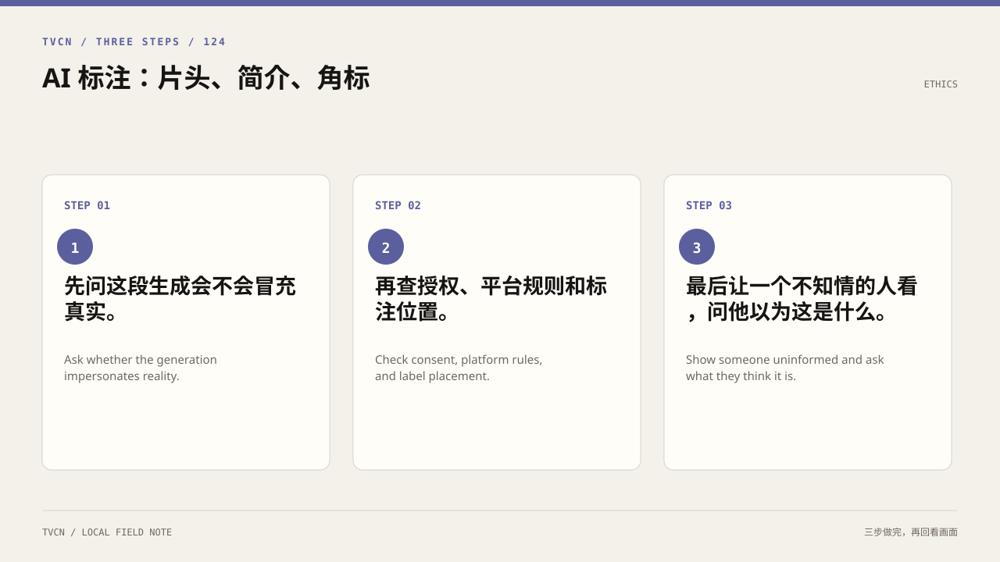

AI 标注要可见、具体、说清哪部分生成了；藏在简介末尾等于没标。

<!-- DIAGRAM_START -->
<h2>图解</h2>
<figure>
  
  <figcaption>把三步按顺序做完，再回看画面或文件。</figcaption>
</figure>
<!-- DIAGRAM_END -->
<h2>现场</h2>

片头或前 3 秒放可见标注：本片部分画面由 AI 生成；简介再写具体哪几段。

<h2>怎么做</h2>

AI 标注要可见、具体、说清哪部分生成了；藏在简介末尾等于没标。
<ol><li>片头或前 3 秒放可见标注：“本片部分画面由 AI 生成”。</li><li>简介再写具体哪几段。</li><li>让一个不知情的人看，问他认为哪段不是实拍。</li></ol>
<h2>别踩</h2>

别把标注藏在简介末尾；观众看不到，就等于没标。

<h2>验收</h2>
<ul><li>前 3 秒能看到 AI 标注，不用暂停找。</li><li>简介写清具体哪几段是生成，不是“部分画面”。</li><li>不知情的人看后能指出至少一段非实拍。</li></ul>

<!-- DEEP_DIVE_START -->
## 深读

<strong>约 7 分钟。</strong> AI 披露不是法律附件，是观众判断“这条片子能不能信”的前提。

### 分清三种使用

全生成、实拍加生成元素、实拍加 AI 辅助后期；三种披露写法不同。全生成要写在首帧或标题下，辅助后期可以在说明里写清用了什么。

不要把“AI 辅助剪辑”写成“AI 生成”，也不要把“全生成”藏成“辅助”；说轻和说重都是不准确。

### 观众需要知道什么

哪一段是生成的、生成的是人物还是背景、声音是不是合成的、有没有真实人物被换脸；四项写清，观众才知道该信什么。

如果生成内容涉及真实人物、品牌、新闻事件，披露要更具体；不要用“部分画面由 AI 辅助”糊过去。

### 平台、客户、自己的网站

平台用自带声明；客户交付时在合同里写“不得移除 AI 标注”；自己网站放在标题下、首帧、简介第一行，三处至少一处显眼。

客户要求不标，先问为什么；涉及真实人物或新闻场景，不接。标注是底线，不是报价项。

### 五分钟练习：一句披露

拿一条含 AI 的片子，写一句：哪段生成、什么模型、生成了什么、实拍保留什么；不超过四十字。

把这句话给一个没看过片子的人，让他说“哪部分不是真的”；说得出，披露才算有效。

### 什么时候算披露到位

观众在观看前能看到、能指出生成段、能区分声音和画面、平台声明与片内一致；四项都过，才算到位。

有一项没过，不要用“在简介最后写了”补；观众不会读到那里。

### AI 披露，十项检查
<ul><li>分清全生成和辅助后期</li><li>全生成写在首帧或标题下</li><li>辅助后期写清用了什么</li><li>写清哪一段生成</li><li>写清人物还是背景</li><li>写清声音是否合成</li><li>真实人物换脸要具体</li><li>平台用自带声明</li><li>合同禁止移除标注</li><li>观众观看前能看到</li></ul>
披露的目的不是免责，是让观众在看之前就知道该把这条片子放在什么位置。

<!-- DEEP_DIVE_END -->
