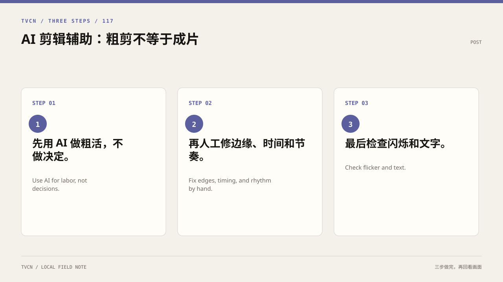

AI 剪辑辅助可以帮你找素材、切静音，但结构和小动作仍要人来定。

<!-- DIAGRAM_START -->
<h2>图解</h2>
<figure>
  
  <figcaption>把三步按顺序做完，再回看画面或文件。</figcaption>
</figure>
<!-- DIAGRAM_END -->
<h2>现场</h2>

让 AI 做三件粗活：找同义镜头、切静音、生成字幕；结构、表演和节奏留给人。

<h2>怎么做</h2>

AI 剪辑辅助可以帮你找素材、切静音，但结构和小动作仍要人来定。
<ol><li>让 AI 做三件粗活：找同义镜头、切静音、生成字幕。</li><li>结构、表演和节奏留给人。</li><li>自动结果逐条检查，不直接交付。</li></ol>
<h2>别踩</h2>

别让 AI 自动剪定结构；它不懂你的重点。

<h2>验收</h2>
<ul><li>AI 只做了找镜头、切静音、生成字幕三类粗活。</li><li>结构和表演由人决定，自动结果没有直接交付。</li><li>逐条检查后，至少改掉一个 AI 误判。</li></ul>
