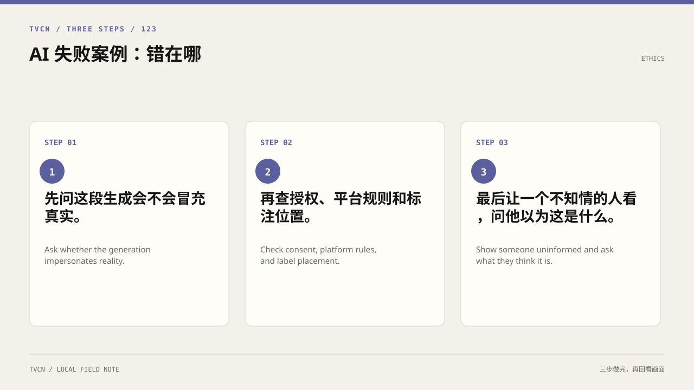

AI 失败案例要写清错在提示、模型还是后期；只说“AI 不行”学不到东西。

<!-- DIAGRAM_START -->
<h2>图解</h2>
<figure>
  
  <figcaption>把三步按顺序做完，再回看画面或文件。</figcaption>
</figure>
<!-- DIAGRAM_END -->
<h2>现场</h2>

记录失败四要素：提示、模型版本、参考图、后期；复现一次，确认是提示问题还是模型问题。

<h2>怎么做</h2>

AI 失败案例要写清错在提示、模型还是后期；只说“AI 不行”学不到东西。
<ol><li>记录失败四要素：提示、模型版本、参考图、后期。</li><li>复现一次，确认是提示问题还是模型问题。</li><li>写下一句可执行的修正，不只写“别用 AI”。</li></ol>
<h2>别踩</h2>

别把失败都怪模型；提示和后期也会制造同样的崩点。

<h2>验收</h2>
<ul><li>失败记录有提示、模型版本、参考图和后期四项。</li><li>能复现一次，并指认问题出在哪一项。</li><li>结论是一句可执行的修正，不是“AI 不行”。</li></ul>
