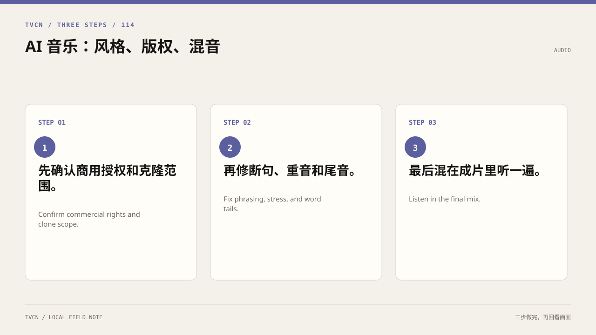

AI 音乐先确认商用授权，再谈风格；混音时把它放到对白下面。

<!-- DIAGRAM_START -->
<h2>图解</h2>
<figure>
  
  <figcaption>把三步按顺序做完，再回看画面或文件。</figcaption>
</figure>
<!-- DIAGRAM_END -->
<h2>现场</h2>

先查商用授权和训练来源；混音时把音乐降到 -18 到 -22 LUFS，对白保持 -14 左右。

<h2>怎么做</h2>

AI 音乐先确认商用授权，再谈风格；混音时把它放到对白下面。
<ol><li>先查商用授权和训练来源。</li><li>混音时把音乐降到 -18 到 -22 LUFS。</li><li>对白保持 -14 左右，音乐不能盖过字。</li></ol>
<h2>别踩</h2>

别用来源不明的 AI 音乐商用；授权不清，平台下架比混音更快。

<h2>验收</h2>
<ul><li>音乐的商用授权和训练来源都有记录。</li><li>音乐混在 -18 到 -22 LUFS，对白保持在 -14 左右。</li><li>独奏对白时每个字都清楚，音乐没有盖住辅音。</li></ul>
