<!-- DIAGRAM_START -->
<h2>图解</h2>
<figure>
  
  <figcaption>示意：按顺序过六关；前两关不过，后面的调色和音乐都白做。</figcaption>
</figure>
<!-- DIAGRAM_END -->
<h2>先定“可接受”的底线</h2>
先写一张底线表：哪些错误一票否决（多指、断肢、脸变、口型完全不对、品牌文字乱码），哪些可以修（轻微噪点、边缘闪烁、背景小物件）。没有底线，审片会变成“再生成一条看看”，永远停不下来。

每条镜头至少看三遍：正常速度、逐帧、静音。正常速度看故事，逐帧看手/眼/边缘，静音看口型和动作是否同步。
<h2>六关：按顺序，不跳关</h2>
第一关人物：脸、发际线、服装、体型是否同一人。第二关动作：动作是否连续，时间是否倒流，物体有没有穿模。第三关口型与声音：口型对不上、声音不像同一人，直接退。第四关文字：画面里的字、logo、字幕是否可读，有没有乱码。第五关物理：影子、反射、重力、液体是否成立。第六关权利：素材、肖像、音乐、AI 标注是否齐全。

一关不过，不进下一关。先修人物再调色，先修口型再加音乐；顺序错了，返工翻倍。
<h2>修，不靠“再抽一次”</h2>
能局部修就局部修：换脸、补手、修口型、替换背景文字，优先用局部重绘/合成，不要整条重生成。整条重生成会改变已经通过的表演和光线，回到第一关。

每条失败记录一行：镜头号、错误类型、模型/版本、提示词版本、修复方法、耗时。十次之后，你会知道是模型不行、提示词不行，还是素材不行。
<h2>交付与标注：别让观众猜</h2>
交付前按平台要求标注 AI 生成：全生成、实拍加生成元素、实拍加 AI 后期，三种标注不同。片头/简介/角标选一种，不要藏在小字里。涉及真实人物、品牌、新闻事件，标注要更具体。

保留生成记录：模型、日期、提示词、种子、输出。不是给观众看，是出问题时能回溯。没有记录，就无法证明哪一版是最终版。
<h2>失败案例：脸对了，手没对</h2>
一条 AI 人物短片，审片只看脸，觉得一致性很好。交付后发现第三镜端杯子的手有六根指，第五镜手指穿进杯壁。重生成整条后，脸又变了，只能回到第一版做局部合成。

补救不是“AI 都这样”，是把六关写进流程。脸和手分开检查，局部修优先，整条重生成最后才用。
<h2>成本与验收</h2>
低成本：人工逐帧 QC + 局部修，¥2,000–6,000。中成本：QC 表、局部重绘、口型/文字修复，¥6,000–20,000。高成本：多模型对比、合成师、法律/授权审核，¥20,000–60,000+。
<h2>验收</h2><ul><li>底线表写清一票否决和可修项。</li><li>每条镜头正常/逐帧/静音各看一遍。</li><li>六关按顺序过，不跳关。</li><li>局部修优先，整条重生成最后。</li><li>失败记录含模型、提示词、修复、耗时。</li><li>AI 标注按平台和内容类型写清。</li></ul>
<!-- SOURCES_START -->
<h2>参考与延伸阅读</h2>

经验来源：TVCN 现场手册与项目复盘；实测来源：页面标注的复核环境与可复现练习；参考来源：以下公开链接。

<ul><li>[S04] 《生成式人工智能服务管理暂行办法》</li><li>[S05] 欧盟 AI Act 政策页</li><li>[S19] GAN 原始论文（2014）</li><li>[S20] DDPM 原始论文（2020）</li></ul>

<a href="../../SOURCES.md">完整链接与用途见 SOURCES.md</a>

<!-- SOURCES_END -->
