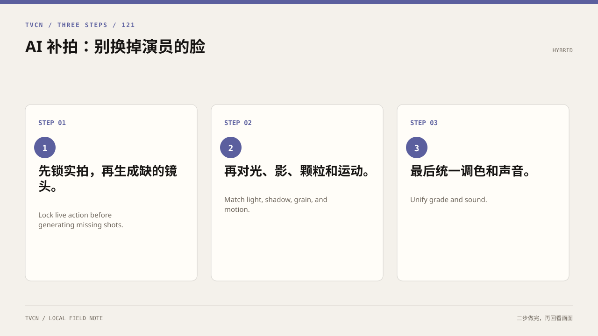

AI 补拍可以换背景、换天气、补人群，别轻易换演员的脸。

<!-- DIAGRAM_START -->
<h2>图解</h2>
<figure>
  
  <figcaption>把三步按顺序做完，再回看画面或文件。</figcaption>
</figure>
<!-- DIAGRAM_END -->
<h2>现场</h2>

只换背景、天气、群演；主演的脸保留实拍，用遮罩和跟踪，不要整脸生成。

<h2>怎么做</h2>

AI 补拍可以换背景、换天气、补人群，别轻易换演员的脸。
<ol><li>只换背景、天气、群演。</li><li>主演的脸保留实拍，用遮罩和跟踪。</li><li>不要整脸生成，除非有书面授权和明确标注。</li></ol>
<h2>别踩</h2>

别轻易换主演的脸；观众认脸，一换就出戏。

<h2>验收</h2>
<ul><li>替换只发生在背景、天气或群演，主演脸仍是实拍。</li><li>遮罩和跟踪没有让脸边缘抖动。</li><li>没有书面授权时，没有整脸生成。</li></ul>
