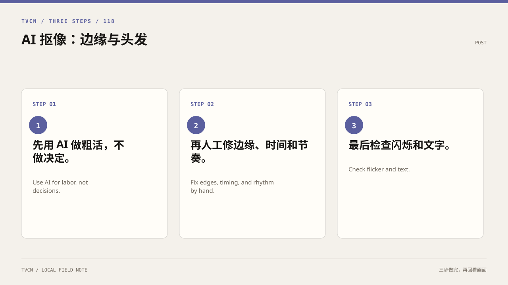

AI 抠像先看头发、手指和透明物；这三处过了，才算能用。

<!-- DIAGRAM_START -->
<h2>图解</h2>
<figure>
  
  <figcaption>把三步按顺序做完，再回看画面或文件。</figcaption>
</figure>
<!-- DIAGRAM_END -->
<h2>现场</h2>

先测三帧：头发边缘、手指缝、透明杯；边缘闪烁就加手动遮罩，不要全局一键。

<h2>怎么做</h2>

AI 抠像先看头发、手指和透明物；这三处过了，才算能用。
<ol><li>先测三帧：头发边缘、手指缝、透明杯。</li><li>边缘闪烁就加手动遮罩。</li><li>不要全局一键，先修最难的三个边缘。</li></ol>
<h2>别踩</h2>

别用一键抠像交付；头发和手指边缘会一帧一跳。

<h2>验收</h2>
<ul><li>头发、手指缝和透明杯三帧边缘都干净。</li><li>边缘没有逐帧闪烁或吃掉主体。</li><li>最难的三个边缘都有手动遮罩，不是全局一键。</li></ul>
