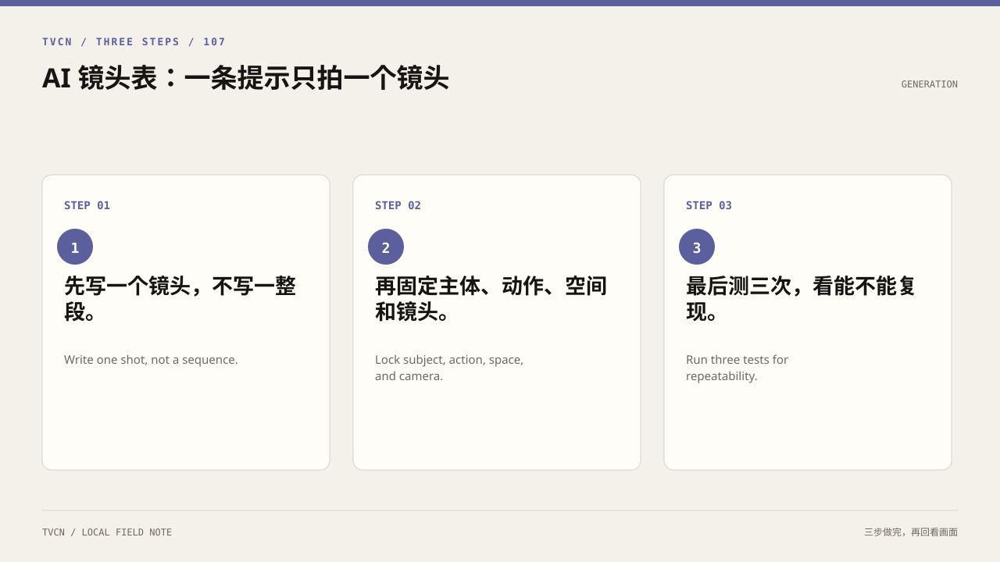

AI 镜头表一条提示只拍一个镜头；一条提示塞三件事，模型会自己剪成乱片。

<!-- DIAGRAM_START -->
<h2>图解</h2>
<figure>
  
  <figcaption>把三步按顺序做完，再回看画面或文件。</figcaption>
</figure>
<!-- DIAGRAM_END -->
<h2>现场</h2>

每条提示只写一个镜头，时长 3 到 5 秒；镜头表写镜号、提示、参考图、首尾帧，生成后按镜号命名。

<h2>怎么做</h2>

AI 镜头表一条提示只拍一个镜头；一条提示塞三件事，模型会自己剪成乱片。
<ol><li>每条提示只写一个镜头，时长 3 到 5 秒。</li><li>表里写镜号、提示、参考图、首尾帧。</li><li>生成后按镜号命名，剪辑时按编号找条。</li></ol>
<h2>别踩</h2>

别在一条提示里写三件事；模型会把它们剪成一条乱片。

<h2>验收</h2>
<ul><li>每条提示只对应一个镜头和一个 3 到 5 秒的时长。</li><li>镜头表有镜号、提示、参考图和首尾帧四列。</li><li>输出文件按镜号命名，剪辑能直接对上。</li></ul>

<!-- DEEP_DIVE_START -->
## 深读

<strong>约 6 分钟。</strong> AI 镜头表的价值不是让模型一次生成整片，而是让每个镜头只回答一个问题。

### 一条提示只解决一个镜头问题

主体、动作、环境、镜头四段写全，但只改一个变量。今天测脸，明天测走位，不要一次改五个词，不然你不知道哪句起作用。

一个镜头只写一个动作。想让角色开门、回头、说话，拆成三条；生成工具不会替你做分镜。

### AI 镜头表的验收

看四件事：还是不是同一个人、动作有没有穿模、光线和上一镜接不接、画面里有没有多余手指和文字。每条生成三次，选最差也能用的那条，不要选最好看的例外。

把每次失败记成一行：脸、手、服装、光。十次以后你会知道该换工具，还是该改提示。

### 四段字段怎么写

主体只写外观和身份，动作只写一个动词，环境只写光线和空间，镜头只写景别和运动。每段一句，不要在一段里塞三个形容词。

先写中文再翻成英文，常常会丢掉具体名词；直接用能看见的词写，模型才知道你要什么。

### 失败记录表

每次生成记四列：第几条、坏在哪、改了什么、结果有没有变好。没有这张表，你会在同一个坑里生成二十次。

每周回看一次，把“换工具”与“改提示”分开统计。大多数问题不是模型笨，是提示里同时改了太多东西。

### 生成前，先把这十项写死
<ul><li>一条提示只改一个变量</li><li>主体写外观和身份，不写性格</li><li>动作只写一个动词</li><li>环境写光线和空间</li><li>镜头写景别和运动</li><li>每个镜头生成三次</li><li>选最差也能用的那一条</li><li>失败记录写清脸、手、服装、光</li><li>同一角色固定参考图和种子</li><li>每五镜并排检查一次一致性</li></ul>
AI 镜头表不是让模型替你导演，是把你的判断拆成一张可以复现的纸。把成功的提示词原样存进项目文档，不要只存截图，下周你还要复现同一条。

<!-- DEEP_DIVE_END -->
