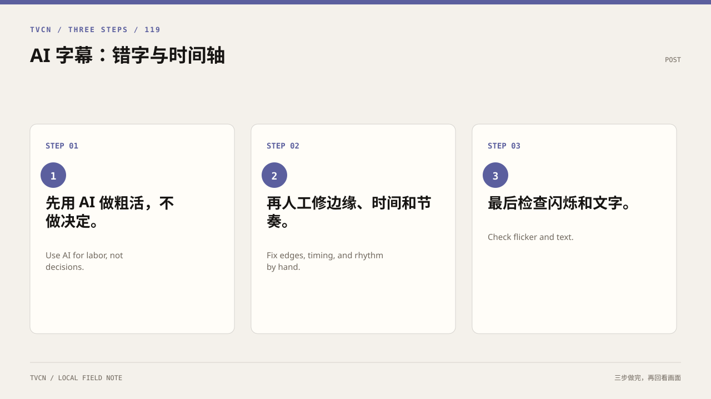

AI 字幕先改人名、数字、术语，再调时间轴；自动识别最常错这三类。

<!-- DIAGRAM_START -->
<h2>图解</h2>
<figure>
  
  <figcaption>把三步按顺序做完，再回看画面或文件。</figcaption>
</figure>
<!-- DIAGRAM_END -->
<h2>现场</h2>

先建术语表：人名、品牌、数字、缩写；识别后逐条替换，再把时间轴整体延后或提前 0.2 秒对齐。

<h2>怎么做</h2>

AI 字幕先改人名、数字、术语，再调时间轴；自动识别最常错这三类。
<ol><li>先建术语表：人名、品牌、数字、缩写。</li><li>识别后逐条替换。</li><li>再把时间轴整体延后或提前 0.2 秒对齐。</li></ol>
<h2>别踩</h2>

别直接交付自动字幕；人名和数字错一次，可信度就掉。

<h2>验收</h2>
<ul><li>人名、品牌、数字和缩写都按术语表替换过。</li><li>时间轴整体对齐，字幕没有早于或晚于语音。</li><li>逐条抽十个词复核，没有明显错字。</li></ul>
