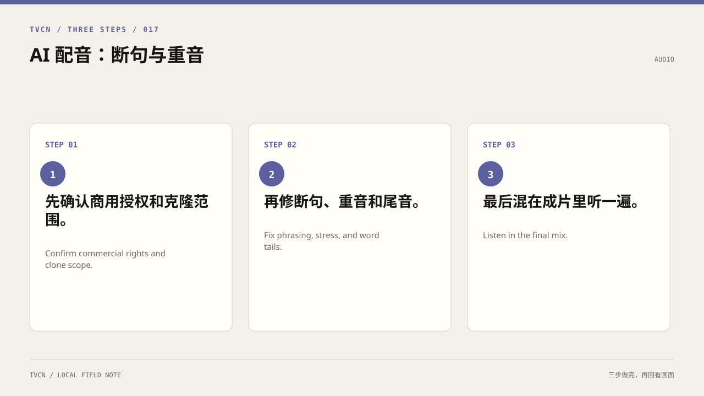

AI 配音先把断句、重音、停顿写进文本，再选音色；音色救不了错误断句。

<!-- DIAGRAM_START -->
<h2>图解</h2>
<figure>
  
  <figcaption>把三步按顺序做完，再回看画面或文件。</figcaption>
</figure>
<!-- DIAGRAM_END -->
<h2>现场</h2>

把台词改成短句，逗号处停 300 毫秒，句号停 600 毫秒；数字写成中文，缩写展开，再生成。

<h2>怎么做</h2>

AI 配音先把断句、重音、停顿写进文本，再选音色；音色救不了错误断句。
<ol><li>把台词改成短句，逗号处停 300 毫秒，句号停 600 毫秒。</li><li>数字写成中文，缩写展开，重音标在关键词上。</li><li>生成后用手机外放听一遍，检查齿音、尾音和重音。</li></ol>
<h2>别踩</h2>

别只用耳机听；手机外放会暴露齿音和尾音问题。

<h2>验收</h2>
<ul><li>逗号和句号的停顿能听出来，断句没有连成一串。</li><li>数字和缩写都读对了，重音落在关键词上。</li><li>手机外放听一遍，齿音不刺、尾音不吞、重音不歪。</li></ul>
<!-- SOURCES_START -->
<h2>参考与延伸阅读</h2>

经验来源：TVCN 现场手册与项目复盘；实测来源：页面标注的复核环境与可复现练习；参考来源：以下公开链接。

<ul><li>[S04] 《生成式人工智能服务管理暂行办法》</li><li>[S05] 欧盟 AI Act 政策页</li><li>[S19] GAN 原始论文（2014）</li><li>[S20] DDPM 原始论文（2020）</li></ul>

<a href="../../SOURCES.md">完整链接与用途见 SOURCES.md</a>

<!-- SOURCES_END -->
