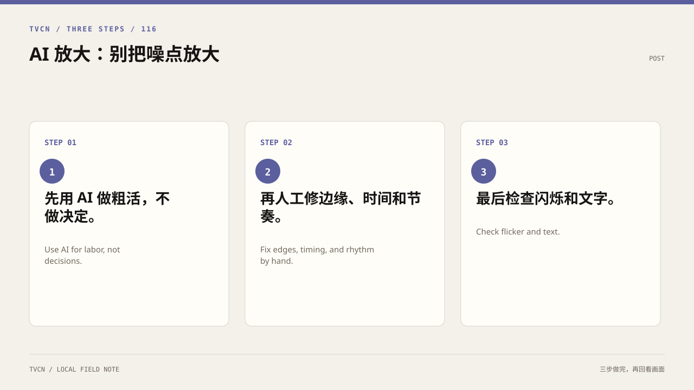

AI 放大先看噪点和边缘；把噪点放大成细节，是最常见的假清晰。

<!-- DIAGRAM_START -->
<h2>图解</h2>
<figure>
  
  <figcaption>把三步按顺序做完，再回看画面或文件。</figcaption>
</figure>
<!-- DIAGRAM_END -->
<h2>现场</h2>

先用 50% 放大看噪点，再用 200% 看边缘；如果噪点变成细节，降低锐化或换模型。

<h2>怎么做</h2>

AI 放大先看噪点和边缘；把噪点放大成细节，是最常见的假清晰。
<ol><li>先用 50% 放大看噪点。</li><li>再用 200% 看边缘，确认没有把噪点当纹理。</li><li>如果噪点变成细节，降低锐化或换模型。</li></ol>
<h2>别踩</h2>

别把锐化拉满当清晰；噪点一放大，画面更脏。

<h2>验收</h2>
<ul><li>50% 下噪点没有变成颗粒纹理。</li><li>200% 下边缘干净，没有光晕或锯齿。</li><li>和原始并排看，清晰度提升来自边缘，不是来自噪点。</li></ul>
