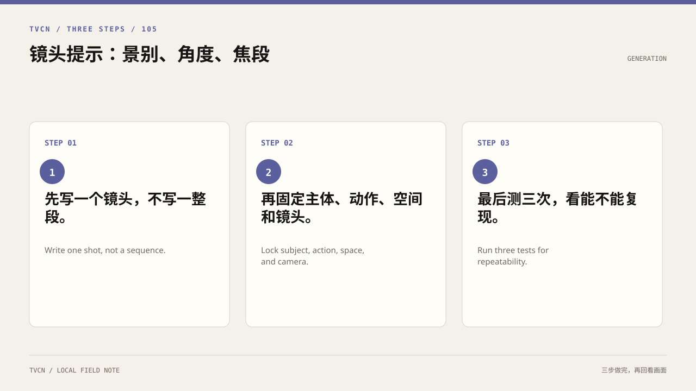

镜头提示写三样：景别、角度、焦段；不写这三样，模型只能猜。

<!-- DIAGRAM_START -->
<h2>图解</h2>
<figure>
  
  <figcaption>把三步按顺序做完，再回看画面或文件。</figcaption>
</figure>
<!-- DIAGRAM_END -->
<h2>现场</h2>

写中景、平视、35mm、人物在画面右三分之一，再加运动；景别和焦段分开写。

<h2>怎么做</h2>

镜头提示写三样：景别、角度、焦段；不写这三样，模型只能猜。
<ol><li>写中景、平视、35mm。</li><li>再把人物放在画面右三分之一，补一句运动。</li><li>景别和焦段分开写，不要合成一个形容词。</li></ol>
<h2>别踩</h2>

别只写“电影镜头”；景别、角度、焦段缺一个，模型就会猜。

<h2>验收</h2>
<ul><li>提示里能分别找到景别、角度和焦段三个词。</li><li>人物位置写到具体三分区，不是“构图好看”。</li><li>输出能对上中景、平视和 35mm 的视角。</li></ul>
