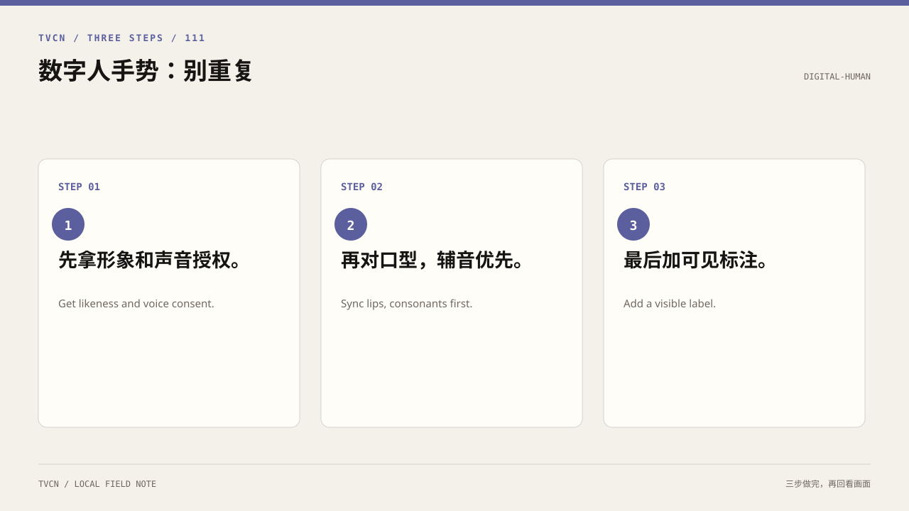

数字人手势最怕循环；每十五秒换一次重心，或者让手离开画面。

<!-- DIAGRAM_START -->
<h2>图解</h2>
<figure>
  
  <figcaption>把三步按顺序做完，再回看画面或文件。</figcaption>
</figure>
<!-- DIAGRAM_END -->
<h2>现场</h2>

每 15 秒设计一个动作：拿起杯子、转身、离开画面；不要让手在身前重复摆动。

<h2>怎么做</h2>

数字人手势最怕循环；每十五秒换一次重心，或者让手离开画面。
<ol><li>每 15 秒设计一个动作：拿起杯子、转身、离开画面。</li><li>不要让手在身前重复摆动。</li><li>回放时盯手和重心，发现循环就换动作。</li></ol>
<h2>别踩</h2>

别让数字人一直站在同一个重心上摆手；循环一出现，假感就出现。

<h2>验收</h2>
<ul><li>每 15 秒有一次重心或动作变化，不是同一姿势循环。</li><li>手至少有一次离开画面或接触物件。</li><li>回放盯手十秒，看不出重复摆动。</li></ul>
