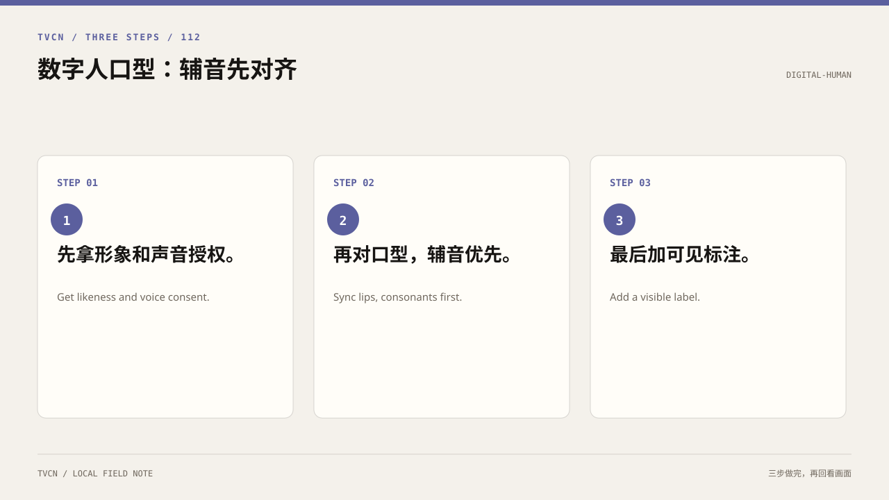

数字人口型先对辅音，尤其是 p、b、m；元音差一点，观众还能忍。

<!-- DIAGRAM_START -->
<h2>图解</h2>
<figure>
  
  <figcaption>把三步按顺序做完，再回看画面或文件。</figcaption>
</figure>
<!-- DIAGRAM_END -->
<h2>现场</h2>

先对 p、b、m 三个辅音，再看元音；口型差一帧，观众会觉得声音不在画面里。

<h2>怎么做</h2>

数字人口型先对辅音，尤其是 p、b、m；元音差一点，观众还能忍。
<ol><li>先对 p、b、m 三个辅音。</li><li>再看元音和停顿。</li><li>口型差一帧就回退那一句重生成，不整体重跑。</li></ol>
<h2>别踩</h2>

别先调元音；爆破音不对，观众立刻觉得声音不在画面里。

<h2>验收</h2>
<ul><li>p、b、m 三个爆破音的闭唇帧对得上。</li><li>元音和停顿没有明显提前或滞后。</li><li>发现问题只回退那一句，没有整段重生成。</li></ul>
