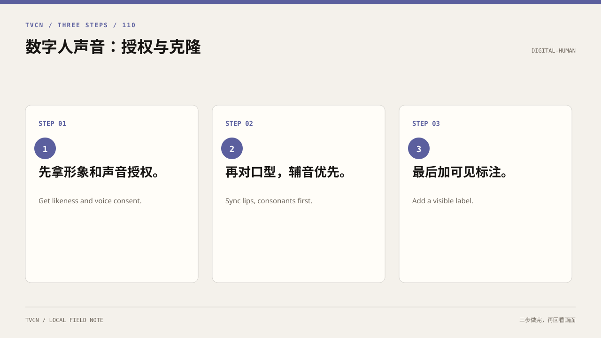

数字人声音先拿授权，再定使用范围；能克隆不等于能随便用。

<!-- DIAGRAM_START -->
<h2>图解</h2>
<figure>
  
  <figcaption>把三步按顺序做完，再回看画面或文件。</figcaption>
</figure>
<!-- DIAGRAM_END -->
<h2>现场</h2>

授权书写清：谁的声音、用在哪、用多久、能不能再训练；没有书面授权就不克隆。

<h2>怎么做</h2>

数字人声音先拿授权，再定使用范围；能克隆不等于能随便用。
<ol><li>授权书写清：谁的声音、用在哪、用多久、能不能再训练。</li><li>没有书面授权就不克隆。</li><li>成片片头和简介标注 AI 配音。</li></ol>
<h2>别踩</h2>

别把生成台词当真实引语；那是伪造，不是配音。

<h2>验收</h2>
<ul><li>授权书覆盖声音身份、用途、期限和再训练四项。</li><li>没有书面授权的声音没有被克隆或使用。</li><li>片头和简介都能看到 AI 配音标注。</li></ul>
